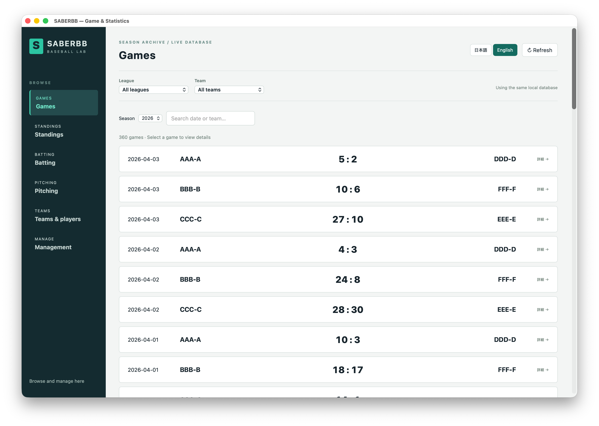

# saberbb

`saberbb` is a Rust CLI baseball simulation and statistics app. It generates
players, schedules seasons, simulates games, stores results in SQLite, and provides a Dioxus desktop GUI for management, standings and game results.

## Features

- Generate simulated baseball players with batting, pitching, fielding, and
  running attributes
- Schedule seasons and process game rounds
- Persist players, schedules, games, counts, and player game stats in SQLite
- Manage seasons and view standings and processed games in the desktop GUI
- Step through individual game counts with keyboard controls
- Support English and Japanese UI text through Fluent locale files

## Screenshots



## Requirements

- Rust toolchain with Cargo
- A SQLite database initialized with the project schema and seed data from
  [`migrations/`](migrations/)

The project uses Rust edition 2024. If your installed Rust version is old,
update it with `rustup update`.

## Quick Start

```sh
cargo build
cargo test
cargo run -- --help
```

Initialize the configured database from the project root:

```sh
cargo run -- --setup
```

This runs all `.sql` files in `migrations/ddl` followed by `migrations/dml`,
in filename order within each directory, then imports `migrations/data/first_names.csv`
and `migrations/data/last_names.csv` into their respective tables, preserving IDs
and all CSV fields. Both CSV files are required. Everything runs in a single
transaction; if a script or import fails, the changes are rolled back.
The scripts recreate tables and reset their
data, so use this command for a fresh database or an intentional reset. Setup
runs before any other options supplied in the same invocation.

For an existing database created before
`pitcher_character` was added, run
[`migrations/upgrades/add_pitcher_character.sql`](migrations/upgrades/add_pitcher_character.sql)
once instead of rebuilding the tables. This preserves existing pitchers and assigns
`Balanced` to them. Do not run this upgrade on a newly initialized database.

For databases created before `catcher_info` was added, run
[`migrations/upgrades/add_catcher_info.sql`](migrations/upgrades/add_catcher_info.sql)
once. It preserves catcher fielding data and initializes their calling style to
`Balanced`. New databases use `migrations/ddl/catcher_info_table.sql` instead.

Existing databases also need
[`migrations/upgrades/add_catcher_calling_style_weights.sql`](migrations/upgrades/add_catcher_calling_style_weights.sql)
once to configure randomized calling styles for newly generated catchers. New
databases receive these weights from `migrations/dml/item_weighted_sample.sql`.

For existing databases, run
[`migrations/upgrades/add_batting_contact_diagnostics.sql`](migrations/upgrades/add_batting_contact_diagnostics.sql)
once before saving new games. This preserves existing records; the new diagnostic
columns remain `NULL` for historical rows and takes. See
[`docs/batting_contact_diagnostics.md`](docs/batting_contact_diagnostics.md) for field definitions and analysis queries.

For existing databases, also run
[`migrations/upgrades/add_fielding_catch_diagnostics.sql`](migrations/upgrades/add_fielding_catch_diagnostics.sql)
once to enable fielding catch diagnostics. See
[`docs/fielding_catch_diagnostics.md`](docs/fielding_catch_diagnostics.md) for columns and single-pitch queries.

To record one diagnostic row per active fielder and fielded pitch, apply
[`migrations/upgrades/add_fielding_candidate_diagnostics.sql`](migrations/upgrades/add_fielding_candidate_diagnostics.sql).
This additive migration is repeatable. New databases also need
`migrations/ddl/player_game_fielding_candidate_table.sql`. See
[`docs/fielding_candidate_diagnostics.md`](docs/fielding_candidate_diagnostics.md)
for stage counts, maximum arrival margins, and analysis queries.

For the independent 10 ms airborne probe of all active fielders, apply
[`migrations/upgrades/add_fielding_air_probe.sql`](migrations/upgrades/add_fielding_air_probe.sql)
once after creating the candidate table. Historical probe columns remain `NULL`.
See [`docs/fielding_air_probe.md`](docs/fielding_air_probe.md) for interpretation and queries.

Typical simulation flow:

```sh
cargo run -- --generate 100
cargo run -- --schedule 1
cargo run -- --process 10
cargo run --features desktop -- --gui
```

The default database file is created at the platform-specific config path for
`jp.cosmi.saberbb`. Override `database_path` in the generated config file if you
want to point the app at a different SQLite file.

## Development

Build:

```sh
cargo build
```

Run tests:

```sh
cargo test
```

Format code:

```sh
cargo fmt
```

## Usage

Show CLI help:

```sh
cargo run -- --help
```

Available commands:

```sh
cargo run -- --setup           # Recreate tables and load seed data
cargo run -- --generate 10     # Generate 10 players and fill vacant team manager positions
cargo run -- --schedule 1      # Schedule 1 season
cargo run -- --process 5       # Process 5 game rounds without detailed contact diagnostics
cargo run -- --analysis 5      # Process 5 game rounds with detailed contact diagnostics
cargo run -- --sampleyear      # Clear game data, reset to this year, schedule 1 season, analyze 40 rounds
cargo run -- --maintenance     # Run SQLite VACUUM and PRAGMA optimize
cargo run -- --tui             # Management console: schedule, characters, game processing
cargo run --features desktop -- --gui  # Dioxus results/statistics GUI
```

`--process` and `--analysis` default to one round when the count is omitted.
`--sampleyear` uses the same analysis path as `--analysis`, recording contact states.
Ordinary processing skips both the detailed contact calculations and their persistence
in `player_game_contact_state`; existing records are retained. Explicit-seed diagnostic
runs continue to record contact states. Recording does not change game outcomes.

Short flags are also available:

```sh
cargo run -- -g 10
cargo run -- -s 1
cargo run -- -p 5
cargo run -- -m
cargo run -- -n
cargo run -- -v
```

## Interactive TUI

Open the TUI with:

```sh
cargo run -- --view
```

The menu includes standings and game results. Default controls are:

| Key | Action |
| --- | --- |
| Up / Down | Move selection |
| Enter | Confirm selection |
| Left / Right | Previous / next count in game detail |
| Esc / Backspace | Back |
| q / Ctrl+C / Ctrl+D | Quit |
| Ctrl+Z | Suspend |

## Configuration

Configuration is loaded with `confy` under the app name `saberbb`. On first run,
missing settings use these defaults:

```toml
version = 1
language = "en-US"
tick_rate = 1.0
frame_rate = 1.0
database_path = "/path/to/saberbb.db"
```

The default database path is `saberbb.db` inside the platform-specific config
directory for `jp.cosmi.saberbb`. Set `language` to `en-US` or `ja-JP` to switch
UI text.

Keybindings are stored by TUI mode. Missing keys are filled from the built-in
defaults, so you can override only the bindings you want to change:

```toml
[keybindings.Home]
"<q>" = "Quit"
"<down>" = "SelectNext"
"<up>" = "SelectPrevious"
"<enter>" = "ConfirmSelection"
```

Logs are written as daily JSON log files under the platform-specific data
directory for `jp.cosmi.saberbb`.

## Database

The SQLite schema and seed SQL files live in:

- [`migrations/`](migrations/)

Database documentation is generated in:

- [`docs/db/README.md`](docs/db/README.md)

The generated docs include the table list and ER diagram.

The DB docs are generated with [`tbls`](https://github.com/k1LoW/tbls):

```sh
tbls doc
```

## Project Structure

```text
src/
  adapters/       Terminal presenters and TUI components
  domain/         Baseball simulation and business logic
  repositories/   SQLite persistence layer
  config.rs       App configuration defaults and loading
  i18n.rs         Localization setup
  main.rs         CLI entry point

docs/
  db/             Generated database documentation
  mmd/            Mermaid diagrams for domain flows and classes
  wiki/           Domain notes

migrations/       SQL schema and seed files
locales/          Fluent translation files
tests/            Integration and simulation tests
```

## License

MIT. See [`LICENSE`](LICENSE).

For a controlled 0.05 s / 0.01 s diagnostic comparison, apply
[`add_fielding_air_probe_comparison.sql`](migrations/upgrades/add_fielding_air_probe_comparison.sql)
once to an existing probe-enabled DB, then run new games.
See [`docs/fielding_air_probe_comparison.md`](docs/fielding_air_probe_comparison.md) for queries.

The normal airborne search now uses 10 ms ticks with a shared event-boundary tolerance.
See [`docs/air_catch_search_validation.md`](docs/air_catch_search_validation.md)
for before/after queries and interpretation (no additional DB migration).

Swing/take decision changes and the one-time diagnostic DB upgrade are described in
[`docs/swing_decisions.md`](docs/swing_decisions.md).

Independent length/thickness miss classification and count/zone/timing queries:
[`docs/contact_miss_diagnostics.md`](docs/contact_miss_diagnostics.md).

Timing-position sensitivity at 100/75/50/0% with fixed contact geometry:
[`docs/timing_contact_probe.md`](docs/timing_contact_probe.md) (one-time bat-angle column upgrade).

75% timing-position trial and before/after contact-quality checks:
[`docs/timing_position_trial.md`](docs/timing_position_trial.md).

HLA component attribution and Marginal timing-resample comparison:
[`docs/hla_components.md`](docs/hla_components.md).

Signed contact-normal HLA trial, migration and before/after checks:
[`docs/contact_normal_hla.md`](docs/contact_normal_hla.md).

EV x VLA, first-ground response and energy-audited tangential collision prototypes:
[`docs/ground_spin_diagnostics.md`](docs/ground_spin_diagnostics.md).

Axial impact attribution: local velocity, rigid recoil and positional effective restitution:
[`docs/axial_response_diagnostics.md`](docs/axial_response_diagnostics.md).

Finite-barrel coupled normal/tangential impulses and spin consistency:
[`docs/finite_barrel_diagnostics.md`](docs/finite_barrel_diagnostics.md).

Single-experiment collision references and read-only per-pitch spin reconstruction:
[`docs/collision_validation.md`](docs/collision_validation.md).

### Generated managers

`--generate N` generates and distributes N players, then generates one manager for
every team that has no manager. Existing managers and assignments are preserved;
repeating the command when all teams have managers creates no extra managers.
`--generate 0` fills manager vacancies without creating players.
Manager names use the same language-specific dictionaries as player names. Each
manager receives one of the four existing batting policies with equal probability:
`let_batter_decide`, `put_ball_in_play`, `seek_line_drive`, or `situational`.
Manager IDs are allocated by SQLite independently of player IDs. Creation and team
assignment are saved together, and concurrent assignments never replace an existing
manager. Existing databases require the batting personnel migration:
`migrations/upgrades/add_batting_personnel.sql`.

## Desktop GUI and management TUI

Dioxus provides both results/statistics and management in one desktop app. The
TUI remains an optional management console for schedules, player/manager generation,
and ordinary or diagnostic game processing. CLI, TUI, and GUI call the same shared
application use cases.

```sh
cargo run -- --tui                       # --view / -v remain aliases
cargo run --features desktop -- --gui
```

The GUI reads the same configured SQLite database as the CLI. It includes league
and team filters, processed-season game lists, scoreboards, game summaries,
per-game batting/pitching tables, pitch-by-pitch navigation and pitch-zone/runner
SVGs, cumulative standings and player statistics, team schedules, player abilities,
pitch repertoires, and manager information. Tables support search, numeric sorting,
and pagination. Statistics retain the existing cumulative aggregation definitions;
the season selector on the game list only filters that list. Refresh reloads the
catalog and active data after management operations. Database work runs off the UI
thread. Viewing screens do not read `player_game_contact_state`.

GUI support is optional so ordinary CLI/TUI builds do not require a WebView SDK.
On macOS, install Apple's command-line tools (`xcode-select --install`). Linux
builds need GTK 3 and WebKitGTK 4.1 development packages, e.g. on Debian/Ubuntu:
`libgtk-3-dev libwebkit2gtk-4.1-dev libxdo-dev libayatana-appindicator3-dev`.
See [Dioxus desktop setup](https://dioxuslabs.com/learn/0.7/guides/platforms/desktop/).

For headless renderer testing, the local-only LiveView example uses the exact same
Dioxus components and database reads, without the native window wrapper:

```sh
cargo test --features gui-tests --lib application::viewing
cargo test --features gui-tests --lib adapters::gui
cargo run --features gui-tests --example gui_browser
# With a test DB containing processed games, dispatch real UI events and save HTML:
cargo run --features gui-tests --example gui_snapshots -- /tmp/saberbb-gui-snapshots
# http://127.0.0.1:8787 ; test harness only, not a public server
```

### GUI language and saved statistics

Use the **日本語 / English** buttons in the GUI header to switch labels and player
name order immediately. Japanese uses family name followed by given name; English
uses given name followed by family name. The preference is saved in the existing
configuration file, retaining the database path and keybindings. Startup language
initialization now overrides any earlier lazy default initialization.

Batting/pitching displays read `batting_stat_totals` and `pitching_stat_totals`.
At game-result save time, the same database transaction updates per-game rows in
`game_batting_stat_cache` / `game_pitching_stat_cache`, then refreshes totals for
only the affected players. Display queries never aggregate pitch logs or per-game
rows. The batting table shows the player's current team and career totals from
all saved games. Batting rates use saved counts, with scoring tag-ups counted
as sacrifice flies and excluded from at-bats. A rate with no qualifying
opportunities displays an em dash. Sacrifice bunts display zero because the
simulator has no bunt outcome. Fielding errors count the recorded fielding
errors attributed to the defender at the interception position.

Existing databases are backfilled automatically on the first statistics request,
which may take time once. The additive schema is also in
`migrations/upgrades/add_stat_cache.sql`; manual SQL application is optional.
To explicitly rebuild derived statistics after manually editing/deleting raw logs:

```sh
cargo run -- --rebuild-stats
```

Rebuilds replace derived values; they do not add counts twice or alter raw pitch
records. `--setup` and `--sampleyear` clear all derived tables with the game data.
Neither the backfill nor display queries read `player_game_contact_state`.

Concurrent first-time statistics requests share one backfill within the application;
changing tabs or filters waits for that backfill instead of starting another writer.
No new games are needed to build statistics from existing logs. A database with no
played games displays empty statistics. Pooled connections wait up to 30 seconds
for locks held by other database work/processes; a persistent lock requires ending
the other transaction and refreshing, not resetting the database. To precompute
an existing database before opening the GUI, close other writers and run
`cargo run -- --rebuild-stats` once.

### GUI management

Open **管理 / Management** in the sidebar to run the same four operations as the TUI:

| Operation | Count | Behavior |
| --- | --- | --- |
| Create schedule | 1–255 seasons | Add future season schedules |
| Generate players & managers | 0–65535 players | Distribute players and fill vacant manager positions; 0 fills managers only |
| Process games | 1–65535 rounds | Simulate scheduled games without detailed contact diagnostics |
| Process with diagnostics | 1–65535 rounds | Simulate games and save detailed contact diagnostics |

Progress is reported after each saved player, season, or completed round. Only one
management job runs at a time in the GUI. Keep the app open until it finishes; page
navigation does not stop a running job. Language and manual refresh controls are
disabled while running. On success or failure, the catalog, statistics, games and
rosters refresh automatically; successful work saved before a failure is retained.
The management operations apply across the leagues rather than to viewing filters.

Game processing now selects the first unfinished scheduled round, including when
moving from the initial seed year or an exhausted season into a scheduled future
season. No pending games is an error without advancing the cursor. Unprocessed
past-season games require inspecting the cursor rather than silently skipping them.
This behavior is shared by CLI, TUI and GUI.

The optional mutating event harness below must use an isolated, freshly initialized
test database with no players or schedules. It checks the real GUI events and DB
writes, including duplicate clicks, page navigation during processing, normal vs.
diagnostic recording, error recovery and automatic refresh:

```sh
cargo run --features gui-tests --example gui_snapshots -- /tmp/gui-management --management
```

### Diagnostic duplicate-key repair

`--setup` now clears additive fielding-candidate/contact diagnostics together with
recreated game data. Older setup runs could leave these rows behind and reuse
game IDs, causing diagnostic primary-key conflicts. See
[the investigation and targeted repair](docs/fielding_candidate_duplicate_investigation.md).
Existing affected databases can remove diagnostics without completed parent games
using `migrations/upgrades/remove_orphaned_game_diagnostics.sql`; this preserves
completed-game diagnostics, results, rosters and schedules. Do not use `--setup`
as a repair command on a database whose existing game data should be retained.

### Expanded standings

The standings panel fills the pane width; only the table inside uses 90% of the panel width, centered with equal side margins.
Every team is shown without a row count or pagination.
A Season selector offers all seasons (the default) and each scheduled year, including seasons with no completed games.
Selecting a year scopes results, batting/fielding totals, rate denominators, and remaining games to that year.
Season views sum the small saved per-game team cache; they do not reaggregate pitch logs.

The GUI standings follow the column order of the
[Sports Navi standings](https://baseball.yahoo.co.jp/npb/standings/): rank, team,
games, wins, losses, draws, winning percentage, games behind, remaining games,
runs, runs allowed, home runs, stolen bases, batting average, ERA, and errors.
Standings use compact fixed-width columns to fit the available horizontal space.
League and season filters are shown; team selection and table search remain available
on other screens. A team selected on another screen does not restrict standings.
Win percentages and
team batting averages omit the leading zero (`.625`, `.250`); `1.000` remains
unchanged. Rates without a denominator display `—` (winning percentage remains
`.000` without a decisive game).

With All seasons selected, remaining games count all created but unplayed schedules,
including future seasons. With a year selected, only that season’s unplayed schedules
are counted. Remaining games are not a fixed league game limit minus games played.
Ranking and games behind are calculated within each league.

`game_team_stat_cache` and `team_stat_totals` are updated in the game-result save
transaction. Team attribution uses the game header and each count's top/bottom
side, preserving history when players change teams. A version-4 cache backfill
runs once on existing databases; `--rebuild-stats`, setup and season reset include
these new derived tables. Subsequent standings reads use saved team totals and
lightweight schedule counts, without reading detailed batting/running/fielding
logs, contact states or fielder-candidate diagnostics.

Team statistics use the following recorded information:

- Runs/runs allowed: completed game scores; home runs: batting results.
- Stolen bases: successful `BaseSteal` events; caught stealing and tag-ups excluded.
- Batting average: hits divided by completed at-bat outcomes (`Single`, `Double`,
  `Triple`, `HomeRun`, `Strikeout`, `Out`, `FieldersChoice`, `DoublePlay`). Takes,
  intermediate strikes, fouls, walks and HBP are excluded. Sacrifice plays are
  not separately classified by the current engine. Existing individual-player
  AB/AVG definitions are unchanged.
- ERA: **reference run-average**, runs allowed × 27 / recorded defensive outs.
  Earned runs are not yet stored. Outs come from the maximum recorded cumulative
  outs in each defensive half-inning; partial walk-off innings count only their
  recorded outs. This limitation is disclosed in the GUI.
- Errors: fielding records with an `error_type` other than NULL/empty/`None`.
  This is the engine's recorded fielding-error count, not an external scorer's
  ruling. Filtered/non-selected fielder-candidate diagnostics are not counted.

### Investigating excessive offense

The career batting table's `AB` counts terminal at-bats, excluding walks, hit by
pitch, takes, swinging strikes, fouls and nonterminal wild pitches. Cache version
4 corrects the previous pitch-record count used as `AB`. Existing databases
rebuild their derived caches once on the first statistics read; saved game logs
and home-run counts are preserved. This corrects the displayed denominator, not
an excessive number of simulated home runs. Sacrifices are not separately
recorded by the current result model.

Run the read-only audit against your saved database (no contact-state logging
or new simulated games required):

```sh
export SABERBB_DB="/path/to/saberbb.db"
python3 tools/diagnostics/offense_audit.py > offense_audit.json
# Optionally restrict the raw-log investigation to one season:
python3 tools/diagnostics/offense_audit.py --season 2026 > offense_audit_2026.json
```

The JSON separates pitch records, PA, AB and HR, reports the HR leader by game,
compares raw records with per-game caches and career totals, and summarizes EV,
launch angles, contact offsets and home-run geometry. `cache_mismatches` can show
incorrect AB values in version-3 caches; compare `raw_hr` and `cached_hr` separately.
The GUI player batting table currently covers all seasons, whereas the standings
can be season-filtered. The audit opens the database read-only and never rebuilds
caches. Normal game results still use `calculate_batted_ball_with_metrics`; the
Intent execution/contact/collision response path is diagnostic shadow data and
does not yet replace that live result calculation.

To investigate a specific outlier, select the displayed PA and HR or supply
`--batter-id ID`. Omit `--season` when matching the career batting screen.

```sh
python3 tools/diagnostics/offense_audit.py --batter-line 525 118 --top 5 > batter_outlier.json
```

This compares the selected batter with their current teammates with the most
plate appearances. The report includes raw and cached totals, batter attributes,
contact rates per swing, exit speed and launch angle distributions, and home-run
rates by stadium. It also flags home runs with unexpected saved trajectories.

To test how much one batter's swing speed contributes, replay swings from
new seeded games using the same pitch, count, runners, and fielders at each
candidate speed:

```sh
cargo run --release --example offense_season_check -- --season 2026 --games 36 --swing-speed-batter-id 150 --swing-speed-ms 33.72,34.5,35.5 > swing_speed_comparison.json
```

This samples the player's team's first 36 scheduled games for each seed.
Alternatives replay one swing at a time, while the current swing speed drives
the continuing game. Compare home runs and other hits per swing or fair
contact. The report also shows the current roster's speeds and paired samples
from the configured generator before and after upper-tail compression.
New batters retain their sampled swing speed up to 35.0 m/s. Above that
point, the generator smoothly compresses samples toward 35.5 m/s. Stored
player speeds are used as-is in games. The report opens `SABERBB_DB` read-only.

To investigate a season with high batting averages and few home runs:

```sh
python3 tools/diagnostics/offense_audit.py --league-batting --season 2026 --top 9 > league_batting_2026.json
```

Omit `--season` to use the latest season with completed regular-season games,
matching the GUI qualified batting filter. The audit reads the saved games and
uses 3.1 PA per game played by a batter's current team, rounded to a whole PA.
`league`, `top_qualified`, and `top_qualified_pool` report K/AB, BABIP, and
in-play hit rates by saved launch-angle band. BABIP includes sacrifice flies.
The launch-angle bands use the saved angle without spin correction. The pool
and league rates use summed counts. `league_ev_vla` and `league_power` report how
often high-EV batted balls occur and how often they become home runs or reach
the wall in the air. Wall impacts with missing fielding time are counted
separately within the wall-impact total. The report requires ordinary saved
game logs and reads them without replaying games.

To investigate hard low-angle singles and the vertical contact that creates
hard fly balls, use the same database and qualification settings:

```sh
python3 tools/diagnostics/offense_audit.py --league-batting --hard-contact --season 2026 --top 9 > hard_contact_2026.json
```

Under `hard_contact`, compare the selected batting leaders with all other
batters. The low-angle tables cover EV of at least 45 m/s and launch angles
from 0° up to 10°. They report singles and outs by exit speed, launch angle,
field-relative direction, first bounce, and the first recorded fielder and
play at first base. `low_angle_shared_geometry` applies the same mix of
EV, launch-angle and direction bins to both cohorts where both have data.
Use the retained ball counts to judge coverage. The first-base split uses
the first recorded GrounderPlay targeting the batter at first. Its field
completion clock can include handling, and delivery can include a carry
to the base. Other targets and missing observations retain their own counts.

`hard_by_launch_angle` summarizes the signed contact offset, adapted
vertical offset and execution error by launch-angle band. Use
`hard_by_vertical_offset` to compare the resulting angles and home-run
counts within each hard-contact EV band. Missing measurement columns or
values remain unknown. The report uses ordinary saved logs. Candidate
reachability and unattempted first-base plays require replay diagnostics.

For extra-base hit diagnostics on ordinary saved games:

```sh
python3 tools/diagnostics/offense_audit.py --season 2026 --extra-base > extra_base_audit_2026.json
```

The optional report adds EV × launch angle bins with home-run counts and
rates. It also groups non-HR outcomes by wall impacts, deep first bounces
in nominal outfield gaps, and other fielding locations. Saved fielding time
excludes projected wall impacts and bounces that would occur after the ball
was fielded. Timing summaries show the first fielding and batted-ball
throw, with batter running time only when the batter was the target.
The logs do not retain fence-crossing height or arrival times for bases
the batter did not attempt. The report works without contact diagnostics. It lists each recorded triple
with season, game ID, count sequence and batter ID. Triple discrepancies are
checked per game/player in the requested scope and across all seasons in the
career cache. A null check indicates a missing cache or column.

### Lift sensitivity and outfield advance clocks

```sh
cargo run --release --example attack_angle_ablation -- --season 2026 --lift-sweep > lift_sweep_2026.json
cargo run --release --example offense_season_check -- --season 2026 --games 36 --outfield-advance-diagnostics > outfield_advance_2026.json
```

The lift sweep uses the same baseline-matched saved contacts for all four
vertical launch angle shifts (-3°, 0°, +3°, +6°). Exit speed, horizontal launch
angle, spin, and stadium geometry stay fixed. The report counts home runs and
airborne wall impacts and compares the attack-angle, bat-tilt and vertical
contact contributions across baseline fair contacts at 40 m/s or above.
Angle attribution uses current batter data. Treat large reconstruction
residuals as unresolved. The sweep measures flight sensitivity, including
possible fair/foul changes, without modeling how a swing adjustment changes EV.

The outfield check uses fresh seeded games and observes the live batter's
second- and third-base clocks, grouped by location, batting result and live
throw target. Both modeled routes start at the actual fielding position.
For plays originally thrown to second with a known receiver, the model
recalculates the return to second without a tag there, then adds the
receiver's preparation, throw to third and tag allowance. The original
defensive clock and the route using the recorded return to second remain
available for comparison. The fastest tested route uses the recalculated
routes from the actual fielding position. Deep-gap and wall-impact doubles
and triples include per-play fielding, throw and batter arrival times.
These timing estimates do not choose new throws, model new runner
decisions or award extra bases. A positive margin means the batter
arrives before the modeled defense.
For wall-impact and deep-gap plays, `deep_extra_base_plays` and
`deep_single_plays` include the selected fielder's starting point, recovery
position, and straight-line displacement, plus bounce and wall events up to
ball control (before handling delay for final pickups). The projected stop position and time describe the uninterrupted
ball path. Final-pickup rows also show search start, modeled travel, waiting
and handling times, and the fallback indicator. Pickup phases are available
only when the live resolver recorded a pickup snapshot.
When final pickup starts at the wall after an earlier first bounce,
`recovery.pre_fence_search` uses the same ball interpolation, selected
fielder, and 0.05 s search step from first bounce up to the wall. It reports
the first reachable point and time gained if one exists. Modeled recovery
uses ordinary rolling-ball handling and the original handling draw when
available. This is a pickup-only comparison with the original play held
fixed; it does not recalculate the throw or batting result.
The observer consumes no random numbers and does not write game results.

For a paired comparison within the same play, read
`outfield_advance_diagnostics.fixed_pickup_comparisons` in the baseline
`--outfield-advance-diagnostics` report. It includes outfield triples and
wall plays where the originally selected fielder could reach the ball before
impact. Both replays hold the batter, other runners, selected fielder and
throw target/cover assignment fixed. They compute defense from the respective
pickup position and ready time, then rerun the normal outfield running
resolver. The pre-fence pickup reuses the original handling draw. A null
`pre_fence` means no complete earlier pickup could be reconstructed.
The live outcome is also recorded because the original throw clock can use
the projected stopping point. Direct routes to second and third and, when
the live target was second, the relay via second are timing comparisons;
they do not select a new throw target or change the replayed running ruling.
Positive ball-minus-batter margins mean the batter arrives first.

The same report includes `outfield_advance_diagnostics.third_base_advance`.
For recorded deep-gap and wall-impact doubles where the live system planned
to stop at second and the defense threw to second, it counts hypothetical
attempts when the batter leads the fastest tested route to third by more
than 0, 0.1, or 0.2 seconds. Counts follow the order of
`required_batter_leads_sec`. Candidate rows list the tested arrivals from
contact, the observed return to second, and the base-occupancy mask (first
= 1, second = 2, third = 4). These are retrospective timing decisions
using the realized recovery and covering assignment. They are not
recorded attempts or a prediction model using only what a runner knows
when rounding second.

Each candidate's `runner_clearance` reports the lead runners' modeled
third-base and home arrivals if they continue running, plus their progress
at the batter's modeled second-base arrival. The clearance screen requires
all lead runners to be projected home before the batter reaches third as
a sufficient condition. A runner who holds at third blocks the advance,
so a passing screen depends on the lead runners continuing. It does not
model their actual decision to hold or their commitment point past third.
The reactive relay clock separately assumes the second-base receiver
initiates the throw to third only after both the batter rounds second and
the ball reaches second. The threshold comparison still uses the fastest
tested route, which allows the defense to act before seeing the batter round.

### Pre-fence pickup trial

```sh
cargo run --release --example offense_season_check -- --season 2026 --games 36 --pre-fence-pickup-comparison > outfield_pre_fence_trial_2026.json
```

Both arms use the same schedules, rosters and per-game starting seeds.
The experimental arm lets outfielders in final-pickup recovery search from
the first bounce to the projected wall impact. It uses ordinary pickup
handling and computes the throw from the selected pickup position. It then
runs the normal baserunning resolver with the new defensive time.
Compare `total` and `pre_fence_pickup` within each seed for hit counts,
doubles and triples per plate appearance, selected pre-fence pickups and
recorded running outs by event. A changed play can change later random draws
within its game. The comparison reads `SABERBB_DB` and saves no game results.

### Signed vertical contact sweep

```sh
cargo run --release --example attack_angle_ablation -- --season 2026 --vertical-contact-sweep > vertical_contact_sweep_2026.json
```

The sweep shifts saved world-vertical contact by -10 to +30 mm in 5 mm steps.
The saved horizontal offset, timing depth, bat tilt, pitch and stadium stay
fixed. The live bat-frame projection, contact limits, exit-speed, launch-angle
and spin calculations determine each trajectory. Baseline geometry, EV, HLA
and flight must match before a contact enters the comparison. Current batter
power is checked through the EV replay. The report counts geometric misses,
changes in the hard-hit lift window (fair, EV at least 40 m/s, VLA 20–50°), exit
speed changes for contacts entering that window, and home runs. The pool contains
recorded positive-EV contacts, so a trial can lose a contact but does not recover
original misses. Treat results as fixed-swing sensitivity, without modeling
swing selection, fielding, or game outcomes.

To add saved swinging misses and compare shifts of 0, +10, +15, and +20 mm:

```sh
cargo run --release --example attack_angle_ablation -- --season 2026 --vertical-contact-sweep --all-swings > all_swing_vertical_sweep_2026.json
```

Use `comparable_swings` as the common denominator. For each shift,
`lost_contacts` and `recovered_contacts` give the paired transitions, and
`geometric_misses` includes original misses that remain misses. Recovered
contacts use the current batter's swing parameters and reproducible draws
from the live face-angle distribution, held fixed across shifts for each
swing. Their fair trajectories and home runs are estimates. The sweep holds
the set of swings fixed and does not model a change in swing decisions or
when a batter would select a power intent.

To compare the 0 mm and +4 mm trajectories on the same simulated swings:

```sh
cargo run --release --example offense_season_check -- --season 2026 --games 36 --vertical-contact-sweep > vertical_contact_paired_cohorts_2026.json
```

In each seed's `paired_zero_to_plus_four_mm` report, compare entries, exits,
and retained swings for fair [40, 47.5) m/s, [10, 15) degree line drives and
for [20, 30) degree home-run trajectories. `entered_from` and `exited_to`
show the flight bands on the other side of each transition, including
geometric misses. `by_baseline_inputs` gives both transition counts against
the same swing count in each joint band of vertical contact displacement,
actual bat angle, and baseline exit speed. The input displacement includes
the existing swing intent offset. The reported trajectories do not rerun
fielding or scoring.

To compare the original contact window with a smaller correction on swings
below 47.5 m/s of baseline exit speed:

```sh
cargo run --release --example offense_season_check -- --season 2026 --games 36 --seeds 113,271,20261109 --vertical-contact-sweep > vertical_contact_window_ev_replay_2026.json
```

Read `window_exit_speed_comparison` for the baseline, the [10, 30) mm window
with +4 mm, and the same window with +2 mm below 47.5 m/s and +4 mm at or
above 47.5 m/s. A baseline geometric miss has no exit speed, so the last
policy keeps +4 mm for misses in the window. The three policies use the same
comparable swings. Compare the fair trajectories at [45, 47.5) m/s and
[20, 25) degrees, the home-run trajectories, and the low line drives. These
are flight counts and do not determine official doubles.

### Vertical contact offsets in full games

```sh
cargo run --release --example offense_season_check -- --season 2026 --games 36 --vertical-contact-comparison > vertical_contact_comparison_2026.json
```

The comparison reads `SABERBB_DB` and runs 36 scheduled games per seed
under each of two conditions. The 0 mm trial uses current behavior. The
+4 mm trial adds 4 mm of world-vertical displacement to every swing,
including swings with the existing LineDrive offset. Both trials run the
normal game loop with the same schedule, rosters and starting seed per
game. Once plays change, later game situations and RNG draws can diverge.
The command saves no game results to the database.

In `vertical_contact_trials`, compare each trial's pooled `total` and its
seed-level `reports` for singles, home runs, and strikeouts per plate
appearance, and BABIP. `vertical_contact_outcomes` reports whiffs per swing
and the recorded batting results in the [7°, 10°) and [10°, 15°) bands
for fair balls with exit speed at least 45 m/s.

Add the contact-Z window policy as a third full-game trial:

```sh
cargo run --release --example offense_season_check -- --season 2026 --games 36 --vertical-contact-comparison --vertical-contact-window > vertical_contact_window_2026.json
```

The third trial applies +4 mm only for pre-trial world-vertical contact
positions in [10, 30) mm. The pre-trial position includes the normal swing
intent offset and is evaluated before the added 4 mm. Reports identify the
policies as `baseline`, `uniform`, and `contact_z_window`. They add slugging
(total bases per at-bat), extra-base hits per plate appearance, official fair
outcomes at [40, 47.5) m/s and [10, 15) degrees, and official home runs at
[20, 30) degrees. All three trials include fielding and baserunning.

To repeat the comparison on three starting seeds independent of the default
set while keeping the same 36 scheduled games per seed:

```sh
cargo run --release --example offense_season_check -- --season 2026 --games 36 --seeds 113,271,20261109 --vertical-contact-comparison --vertical-contact-window > vertical_contact_window_holdout_2026.json
```

Compare `hr_per_pa` and `doubles_per_pa` for each seed and in the pooled
trial totals. The `vertical_contact_outcomes.by_exit_speed_launch_angle_direction`
table records all official fair outcomes for each joint band. Divide a band's
`double` count by the corresponding trial or seed's `total.pa` to compare its
contribution to the overall doubles rate. Divide by the band's `plays` to
compare how often a fair ball in that band became a double. HLA is relative to
the stadium, with negative angles toward third base and positive angles toward
first base.

To compare the exit-speed-dependent window in full games alongside baseline
and the +4 mm window, use the same holdout seeds as the fixed-swing replay:

```sh
cargo run --release --example offense_season_check -- --season 2026 --games 36 --seeds 113,271,20261109 --vertical-contact-comparison --vertical-contact-window --vertical-contact-window-ev > vertical_contact_window_ev_games_2026.json
```

The third policy uses the pre-trial contact geometry to calculate exit speed
without consuming random draws. Within [10, 30) mm, it applies +2 mm below
47.5 m/s and +4 mm at or above it. A pre-trial geometric miss keeps +4 mm in
the window. The three policies run fielding and baserunning. Compare official
singles, doubles and home runs per PA, plus `mid_speed_20_to_25_deg` for the
45–47.5 m/s band and `high_ev_home_runs_20_to_25_deg`.

Replay the two contact-window policies on the same swing and the same initial
fielding and baserunning state:

```sh
cargo run --release --example offense_season_check -- --season 2026 --games 36 --seeds 113,271,20261109 --vertical-contact-paired-fielding > vertical_contact_paired_fielding_2026.json
```

The +4 mm window games supply the pitches, swings and initial play states.
This counterfactual uses the historical automatic ground-rule double award.
The audit branches only where the exit-speed-dependent policy uses +2 mm
and includes the pair if either resulting fair flight has exit speed
[45, 47.5) m/s and launch angle [15, 25) degrees. Both branches use the normal
fielding and baserunning paths. Only the +4 mm result advances the live game.
The paired results estimate the change for these fixed situations.

In `vertical_contact_paired_fielding.total.transitions`, check the
`20_to_25_deg:Double` row for plays that move into `15_to_20_deg:Double`,
become other results, or stay in the same band. Check the other rows for
new doubles in the lower band. Each seed report includes the paired plays,
with ball flight, fielding and runner events for both policies. Set
`SABERBB_DB` as for the other diagnostics.

Pairs with a ground-rule double in either branch include a `fence_audit`.
Compare the first bounce in each branch's `ball` and the signed
`height_above_fence_m` in each fair-fence event. Fence event heights are
measured at the integrator's decision tick, before any reflection. An empty
event list means the flight did not reach a fair fence above ground.

In `total.fence_audit.flat_ground_rule_double_to_ev_direct_catch`, the
opportunity counts refer to the +4 mm branch of the transition. The integrated
path counts evaluate reach and risk before the first bounce or fence contact.
The fielding replay uses the normal estimated path, candidate filters and
error draws from the same post-launch RNG state. The diagnostic leaves the
official game results intact.

Standard games apply the exit-speed-dependent vertical contact window.
Measure world-vertical contact after the intent offset and before the window
shift. Swings in [10, 30) mm get +2 mm below 47.5 m/s of estimated pre-shift
exit speed, and +4 mm at or above 47.5 m/s or on a pre-shift geometric miss.
Swings outside the window get zero additional shift.

The full-game vertical contact comparison still selects each policy
explicitly. The fixed-swing sweep uses zero additional shift for its live
reference games so each replay starts from the uncorrected window input.

A clean direct catch takes precedence in standard games when the projected
trajectory would clear the fence after a bounce. Compare the three contact
policies with this rule on using a separate set of starting seeds:

```sh
cargo run --release --example offense_season_check -- --season 2026 --games 36 --seeds 503,1009,20261120 --vertical-contact-comparison --vertical-contact-window --vertical-contact-window-ev > vertical_contact_ev_holdout_catch_2026.json
```

Compare doubles and home runs per PA for the pooled trials and each seed.
Each trial reports the catch rule setting and the number of trajectories
that ended in an awarded double or a catch before the bounce.

Compare the ground-rule-double catch rule off and on for each contact policy:

```sh
cargo run --release --example offense_season_check -- --season 2026 --games 36 --seeds 113,271,20261109 --vertical-contact-comparison --vertical-contact-window --vertical-contact-window-ev --ground-rule-double-catch-comparison > ground_rule_double_catch_2026.json
```

The rule prioritizes a clean direct catch before the first bounce when the
trajectory would otherwise clear the fence after a bounce. The replay uses
the ordinary fielding resolver. An awarded double keeps the pre-replay
random stream. Pair entries under `vertical_contact_trials` by `policy`
and compare the two `ground_rule_double_catch_enabled` values. The
`ground_rule_double` counts report awarded doubles and actual catches on
qualifying trajectories. Compare `total.doubles_per_pa`, `babip`, `hr_per_pa`
and `runs` to measure the full-game effect. Later plays can diverge when
the rule changes an outcome.

Add the fair-launch audit to compare official outcomes across all exit-speed
and launch-angle bands. The CSV sums the backspin bands and seeds before
dividing by each trial's plate appearances. Rows are ordered by the change in
singles per 100 PA. Sort by `delta_home_runs_per_100_pa` to see the bands where
home runs increased most.

```sh
cargo run --release --example offense_season_check -- --season 2026 --games 36 --vertical-contact-comparison --fair-launch-diagnostics > vertical_contact_launch_2026.json
python tools/diagnostics/vertical_contact_launch_compare.py vertical_contact_launch_2026.json > vertical_contact_launch_2026.csv
```

To check how many of the singles at 40–47.5 m/s and 10–15° could become outs:

```sh
cargo run --release --example offense_season_check -- --season 2026 --games 36 --vertical-contact-comparison --vertical-contact-fielding-diagnostics > vertical_contact_fielding_2026.json
```

Each trial and seed has a `low_line_drive_fielding` report for the half-open
bands [40, 47.5) m/s and [10, 15) degrees. It counts direct catches under the
current, half, and zero catch margins. The full airborne probe also counts
plays where reach was possible only for fielders excluded by the live lane or
distance filter. The first-base model uses the actual ball
control position and time, and tests both a receiver already at first and cover
that starts at ball control. A modeled infield carry can beat the throw. The
combined count deduplicates singles where both a zero-margin catch and the
late-cover first-base play could get an out. These are fixed-play estimates
with game scoring held at the realized result.

### LineDrive intent lift in full games

Normal games apply a +20 mm world-vertical contact offset when a swing has
the selected `LineDrive` intent. `ContactFirst` uses 0 mm. The shift feeds
the existing contact-geometry and flight calculations. It affects newly
simulated games. The diagnostic below can override the standard value for
comparison.


```sh
cargo run --release --example offense_season_check -- --season 2026 --games 36 --line-drive-lift-comparison > line_drive_lift_2026.json
```

Omit `--games` to use the entire schedule for the specified season. To run
only the control and the two shortlisted offsets on that schedule:

```sh
cargo run --release --example offense_season_check -- --season 2026 --line-drive-lift-comparison --line-drive-lift-offsets 0,10,20 > line_drive_lift_full_2026.json
```

Each condition (default 0, +10, +15, +20 mm) uses the same source rosters, schedule
and per-game starting RNG seeds. The trial applies a positive vertical
contact shift before geometry and flight calculation, only on swings with
the existing `LineDrive` intent. The usual player/manager selection decides
when that intent is used. After a result changes, later game states, decisions
and RNG draws may diverge. Results stay in memory and the source DB is read-only.

Each trial reports HR/PA, doubles and triples per PA, runs per game, overall
whiffs per swing, and whiffs per LineDrive swing. The LineDrive swing count
shows how often the intervention was eligible. Whiffs include swinging
third strikes, using the contact result before official scoring. The 0 mm
condition reproduces the previous contact offset, and +20 mm matches the
current standard.

### ContactFirst and LineDrive aim comparison

Set `SABERBB_DB` to the roster and schedule database, then run:

```sh
cargo run --locked --release --example offense_season_check -- --season 2026 --games 36 --intent-aim-comparison > intent_aim_2026.json
```

The four settings use absolute world-vertical contact offsets in millimeters.
The baseline uses ContactFirst 0 and LineDrive +20. The alternatives change
ContactFirst to +8, LineDrive to +32, or both. Set `--contact-first-aim-mm`
and `--line-drive-aim-mm` to change the alternate values. Set one of them
to its baseline value for a comparison of the other intent alone.

Under `intent_aim_comparison.paired_swings.pooled`, compare `all`,
`contact_first` and `line_drive`. Each setting replays the same live
swings with the selected intent, pitch, starting defense, runners, and
random state held fixed. The normal contact window is recomputed for the
new aim. Counts and rates for whiffs, fouls, and fair launch bands use all
swings. `baseline_hard_low_single_destinations` shows the alternate launch
band and official batting result for each original hard low-angle single.

To isolate ContactFirst at 0 versus +8 mm with LineDrive held at +20 mm:

```sh
cargo run --locked --release --example offense_season_check -- --season 2026 --games 36 --intent-aim-comparison --contact-first-aim-mm 8 --line-drive-aim-mm 20 > contact_first_aim_2026.json
```

Compare `baseline.contact_first` and `contact_first_only.contact_first`
inside `paired_swings.pooled`. The `fair_launch_angle_distribution`
counts all non-foul flights by angle and reports their shares within that
arm. The `baseline_5_to_10_deg_single_destinations` table keeps the same
baseline singles at all exit speeds and groups each replay by batting
result and trial angle band, foul flight or no launch. The paired
`line_drive` reports provide a control.

Read `hard_5_to_15_deg_infield` under each paired-swing intent to compare
the four 2.5° angle bands for fair in-park balls at EV of at least 45 m/s.
The report counts the actual selected fielder and handling location
relative to the 50 m infield radius. A separate scan uses the fielding
trajectory estimate up to its first 50 m crossing or known outfielder
touch, whichever comes first. It reports reach
under the live candidate filters and sampling grid, then with relaxed
filters and a 10 ms grid. The scan assumes clean handling and applies
the live air-risk margin. Look at `outfield_singles_by_infield_reach` to
see how many outfield singles had a reachable point. First-bounce
positions are projected, even when an earlier catch ended the play.
The paired transition tables include swings that enter or leave the
target bands and record their batting ruling and fielding location.

`intent_aim_comparison.full_games` reports BA, BABIP, singles per PA and
home runs per PA by setting and seed. These games share the schedule,
rosters and starting seeds. Later plays can diverge as results change.
The tool reads the source database and runs new games in memory.

### ContactFirst exit-speed comparison

Set `SABERBB_DB` to the same roster and schedule database.

```sh
cargo run --locked --release --example offense_season_check -- --season 2026 --games 36 --contact-first-ev-comparison > contact_first_ev_2026.json
```

The comparison takes fair ContactFirst launches at or above 45 m/s from
the baseline games. Each replay keeps the launch angles, spin, ballpark,
fielders, runners and post-launch random state. It reintegrates the
flight at 2, 4 or 6 m/s below the original speed and resolves the play
through normal fielding and baserunning. Use `--exit-speed-reductions-ms`
to pass a different comma-separated list. Each reduction uses the same
baseline contacts, even when the reduced speed falls below 45 m/s.

Under `contact_first_ev_comparison.pooled`, read the totals and original
launch-angle bands for each reduction. Check `OutfieldSingle` in
`baseline_to_trial`, batter outs at first, projected first bounces and
extra-base hits. The baseline supplies all later pitches and situations.
The rates are paired-play rates for these hard contacts.

### ContactFirst exit-speed terms

Set `SABERBB_DB` to the same roster and schedule database.

```sh
cargo run --locked --release --example offense_season_check -- --season 2026 --games 36 --contact-first-ev-terms > contact_first_ev_terms_2026.json
```

`contact_first_ev_terms.pooled` reports all fair ContactFirst launches
and the original high-EV subset in each launch-angle band. The
`target_5_to_10_deg` summary covers the two bands together. The ordered
terms add to the recorded EV, starting with pitch speed and the
32.5 m/s reference bat at neutral power and timing depth. The report then
adds the effects of actual bat speed, swing power, timing depth and the
thickness and length factors in that order.

Read `one_at_a_time` for changes to mean EV and crossings of the 45 m/s
threshold. Removing timing depth changes the bat transfer coefficient.
Removing timing from geometry changes the contact offsets on the bat.
Geometric misses and missing inputs are shown separately. These
sensitivities use the original contacts and angles as the comparison
population and measure EV before flight or fielding.

### ContactFirst swing-speed comparison

Set `SABERBB_DB` to the same roster and schedule database.

```sh
cargo run --locked --release --example offense_season_check -- --season 2026 --games 36 --contact-first-swing-speed-comparison > contact_first_swing_speed_2026.json
```

For each live swing, replay contact geometry, collision, flight, fielding
and baserunning at 100%, 97% and 94% of the player's bat speed. The speed
multiplier applies only to ContactFirst. Each arm starts from the same pitch,
intent, game situation and pre-contact random state. Later pitches use the
live baseline.

In `contact_first_swing_speed_comparison.pooled[*].summary.contact_first`,
`singles_5_to_10_deg` counts singles hit at 5° inclusive to 10° exclusive
at any exit speed. `hard_5_to_15_deg_infield` breaks down balls at or above
45 m/s, including the two sub-bands between 5° and 10°. Check `by_swing_band`
for whiffs and fouls, and `doubles`, `triples` and `home_runs` for extra-base
hits. Rates use all swings in the corresponding intent group. Per-seed
results are available under `reports`.

### Pitch and bat timing geometry comparison

Set `SABERBB_DB` to the roster and schedule database.

```sh
cargo run --locked --release --example offense_season_check -- --season 2026 --games 36 --pitch-bat-timing-comparison > pitch_bat_timing_2026.json
```

The six paired arms combine current ContactFirst aim, an 8 mm undercut,
or a 10° steeper bat attack with either live geometry or an additional
vertical displacement from signed timing error. The displacement uses
the crossing of local straight-line paths in the vertical plane, with
the incoming pitch velocity at the plate and the trial bat attack angle.
Equal path slopes or zero timing error add no displacement. The existing
horizontal timing term stays in place. LineDrive keeps its live aim and
attack in every arm and receives the same timing geometry in the three
arms that enable it. Replays do not affect subsequent pitches.

In `pitch_bat_timing_comparison.pooled`, compare each `trial` with its
counterpart at the other value of `use_path_mismatch`. Use the
ContactFirst summary's whiff rate, `retention_at_least_80_pct_per_swing`,
`retention_at_least_95_pct_per_swing`, `outfield_direct_outs_per_swing`
and `home_runs_per_swing`. Retention uses the simulator's pre-offset EV,
counts foul launches as well, and uses all swings as the rate denominator.
An outfield direct out is a recorded batting out on a clean catch in the
air by an outfielder. The same counts by seed are in `reports`.

### ContactFirst vertical bat control comparison

Set `SABERBB_DB` to the roster and schedule database.

```sh
cargo run --locked --release --example offense_season_check -- --season 2026 --games 36 --vertical-bat-control-comparison > vertical_bat_control_2026.json
```

The live control verifies the replay. The other three arms enable
pitch–bat timing geometry with the current approach, with +10° of
ContactFirst attack, or with +10° and a one-point reduction in the
`bat_control` used for vertical pitch-offset correction. Horizontal and
timing correction, the stored player skill, and the swing decision all
use their live values. The reduced skill is an experimental dose chosen
before contact; the resulting launch angle has no role in selecting it.

Compare pooled and per-seed ContactFirst results for the two +10° arms.
`plus_ten_extra_base_hit_destinations` follows all ContactFirst doubles
and home runs from the +10° control to their outcomes with reduced
vertical correction. The live baseline supplies the later pitches.

To check whether extra doubles narrowly missed becoming home runs, read
`double_fence_diagnostics` under each arm's `summary`. It includes
official doubles awarded after clearing the fence on a bounce, doubles
that hit the wall before or after bouncing, clean fielding before a
projected wall hit, and doubles with no projected wall hit. Each category
reports launch angles and the radial distance from the recorded bounce
or pickup point to the fence on the same bearing when available. The
airborne wall shortfall uses ball height at the first simulated wall
event. An absent pickup or bounce is omitted from its histogram.

### Fixed-contact length retention comparison

Set `SABERBB_DB` to the same roster and schedule database.

```sh
cargo run --locked --release --example offense_season_check -- --season 2026 --games 36 --contact-length-comparison > contact_length_2026.json
```

The comparison replays the same realized contacts for both batting intents.
The alternative curves multiply the current length-direction retention by an
additional factor that equals 1 through 2 cm, decreases smoothly to 0.80
or 0.65 at 10 cm and stays there farther out. The center, contact
classification, bat speed, launch direction and spin are fixed.
Only exit speed changes at launch. The replay then resolves flight,
fielding and baserunning with the normal rules. Later pitches follow the
live baseline.

Under `contact_length_comparison.pooled`, compare
`baseline_fair_retention_by_angle_deg` for the baseline fair-contact cohort.
The bins have 5-percentage-point widths, with 100% included in the 95 bin.
Retention is the product of the thickness and length terms. Compare
`hard_fair_5_to_10_deg` (at least 45 m/s), `singles_5_to_10_deg` (all
exit speeds), and `home_runs` in the same summary. Counts are available for
each intent and for all swings combined. Per-seed results are under `reports`.

### Frozen-contact attack-angle ablation

Run the live Rust trajectory calculation on saved positive-EV batting records,
then vary only the sampled batter-type attack-angle contribution:

```sh
export SABERBB_DB="/path/to/saberbb.db"
cargo run --release --example attack_angle_ablation -- --season 2026 > attack_angle_ablation.json
# Start with the reported 441-HR batter for a smaller, faster comparison:
cargo run --release --example attack_angle_ablation -- --season 2026 --batter-id 7097 > attack_angle_7097.json
```

The output compares baseline, half the AggressiveFreeSwinger bonus, zero that
bonus, and zero all batter-type bonuses. Counts, mean launch angles, mean final
trajectory distances and outcome transition tables are provided for the total,
each batter type and each batter. `source_counts.raw_hr` covers every batting
record, allowing missing positive-EV HR records to be noticed. The comparison
cohort consists of positive-EV records, including fouls.

The baseline must reproduce the saved outbound result, final distance/angle and
time before a record can enter any scenario. Spin is reconstructed using the
same function as live simulation. EV, launch HLA, spin, contact geometry, stadium
(including a saved custom fence) and default wind stay fixed. The actual sampled
angle bonus is inferred by subtracting the shared contact-deflection and dynamic
attack-angle terms from saved VLA; no new random numbers are drawn. This assumes
that the batter's current base attack angle and type match their historical
values. Zero residuals are valid for records made after removal of the direct
bonus. Nonzero legacy residuals must be within 0.5–1.5 times the historical nominal
modifier, but this check cannot prove that the
player has never been edited. Older/missing inputs, baseline mismatches and
trajectory failures are counted in `exclusions`, with example record IDs.

Compare scenario HR counts only within the same `comparable_contacts` pool;
excluded records are not zero-HR outcomes. `comparison_available=false` means
there is no valid comparison. This is a read-only, frozen-contact experiment:
it does not replay pitching, batting decisions, fielding, running or innings,
and does not predict counterfactual BA/ERA or full-season HR totals. Final
trajectory distance includes ground rolling or fence termination and is not
unrestricted airborne carry. No live simulation coefficients are changed.

On the isolated 27-game development fixture, all 2,209 contacts reproduced their
baseline (no exclusions): 180 HR at baseline, 45 with half the aggressive bonus,
25 with no aggressive bonus, and 14 with no type bonus. These are development
fixture results, not estimates for another database's 441-HR batter.

### Live removal of direct batter-type angle bonuses

Live swing execution no longer adds the historical batter-type offsets (10° for
AggressiveFreeSwinger, 2° for ClassicAnalyst, 3° for GameManager). A batter's own
base attack angle and course-dependent dynamic angle remain. The historical RNG
draw is still consumed so removing this term does not independently shift the
random stream at that point. Player/manager preferences, intent selection and
other type-dependent decisions remain in place. Intent execution/collision
responses are still shadow diagnostics, not the live result generator.

Saved results are preserved; the change affects newly simulated games. Use the
read-only full-game check to evaluate a fresh run without resetting your DB:

```sh
export SABERBB_DB="/path/to/saberbb.db"
# Quick check, three seeds:
cargo run --release --example offense_season_check -- --season 2026 --games 36 > offense_season_check.json
# 360 league games (120 per team in a six-team balanced schedule), three seeds:
cargo run --release --example offense_season_check -- --season 2026 --games 360 > offense_season_360.json
```

Omit `--games` to run every scheduled game of that season, completed or pending.
The checker reads current rosters, managers, stadium settings and the requested
schedule; it does not reproduce historical lineups or unknown historical seeds.
Each game starts from its frozen input and a seed derived from the master seed
and game ID, using the same full simulation loop as ordinary play. It does not
save results, advance the cursor or collect contact-state diagnostics. Failure
aborts the run rather than accepting a partial summary. Progress goes to stderr;
JSON goes to stdout. Input and engine hashes identify what was compared.

The reports include batting average, HR/PA, runs, hits by type, strikeouts,
recorded pitching outs, non-strikeout outs, HR leaders and team totals. The RA9
reference uses runs allowed * 27 / recorded outs; earned runs are not recorded.
Non-strikeout outs include baserunning outs. Compare before/after runs only with
matching input hashes, game counts and seed lists. Different outcomes naturally
change subsequent random consumption and plate appearances. Do not combine old
saved statistics and newly generated statistics as one calibration comparison.

See [the full-game comparison and remaining calibration issues](docs/diagnostics/type_angle_bonus_removal.md) for the 360-game, three-seed development check.

### Ball-in-play quality and conversion audit

Append `--bip-diagnostics` to the full-game check to separate contact quality,
fielding paths and running/throwing timings without changing game outcomes:

```sh
export SABERBB_DB="/path/to/saberbb.db"
cargo run --release --example offense_season_check -- --season 2026 --games 36 --bip-diagnostics > bip_audit_36.json
# Full comparison on your current roster, three default seeds:
cargo run --release --example offense_season_check -- --season 2026 --games 360 --bip-diagnostics > bip_audit_360.json
```

Each seed report gains `bip_diagnostics`, including an all-contact quality/foul/HR funnel and per-play outcome counts and hit rates
by engine trajectory, EV (m/s), VLA, contact quality, fielding position, selection
path, catch type and error, plus a joint trajectory/EV/VLA table. Table groups partition
the same terminal BIP population (Single/Double/Triple/Out/FC/DP). Home runs,
strikeouts and nonterminal fouls are excluded. Automatic ground-rule doubles
remain in the denominator and have their own coverage count; missing fielding
records are not mislabeled as zero-time plays. A double play counts as one BIP,
not two outs.

Timing summaries carry their own sample counts; absent values are never replaced
by zero. `target_runner_margin_sec` compares the recorded defense/runner times
only for a known target with positive runner time; it may be a lead runner, not
the batter. Batter first-base times include the live acceleration lag. The
second/third no-lag times deliberately match the current outfield RunningPlan
thresholds, and plan-versus-attempt lag summaries expose the difference from
actual timed attempts. A single followed by the batter being tagged out while
stretching to second is tracked separately from possible classification errors.

The audit includes bounded examples (first four per flag) with game/count IDs,
fielding/running records, relevant batter times and candidate coverage. Air probe
success is a counterfactual search result, not a guaranteed catch. Catch positions
are reconstructed only for error-free DirectFly/BounceCatch records using the
same coarse estimator as fielding; FinalPickup and errors are excluded because
handling delay obscures the interception instant. Final-versus-catch distances
and straight-line distances to the recorded throw target are diagnostic geometry,
not corrected throw times or counterfactual safe/out decisions.

This is an observer over completed GameResult records: no new RNG, no new contact
logging, no DB writes, and no changes to physics, running or fielding coefficients.
A missing flag key means zero occurrences; samples are illustrative, not randomly
representative. See [BIP diagnostic findings](docs/diagnostics/bip_conversion_audit.md)
for coverage, parity checks and the initial development fixture findings.

For a frozen-contact HLA component comparison and same-target throw-origin timing
comparison, add `--contact-direction-diagnostics` alongside `--bip-diagnostics`.
See [definitions, limitations and running clock correction](docs/diagnostics/contact_direction_audit.md).

### Frozen-contact moving-bat comparison

Compare the recorded live outcome with stationary/moving normal and full finite
collision responses, including HLA-only sensitivity and common-contact controls:

```sh
export SABERBB_DB="/path/to/saberbb.db"
cargo run --release --example offense_season_check -- --season 2026 --games 360 --moving-collision-diagnostics > moving_collision_360.json
```

This observer retains the live contact cohort, saves no results/contact states,
and reports model exclusions and separate matched denominators. The legacy 3-D
pose is a documented proxy, not a measured state. See [model assumptions, spin
projection and output definitions](docs/diagnostics/moving_collision_audit.md).

### Selected Intent forward 3-D path

Compare live contact/miss labels with the selected Intent's existing execution
and 3-D contact search, then aggregate its finite collision/flight response:

```sh
export SABERBB_DB="/path/to/saberbb.db"
cargo run --release --example offense_season_check -- --season 2026 --games 360 --selected-intent-diagnostics > selected_intent_3d_360.json
```

This flag collects raw shadow states for one game at a time in memory and saves
none to the database. It includes legacy misses, separates unresolved searches
and model exclusions, and preserves ordinary results. See [cohorts, assumptions
and validation](docs/diagnostics/selected_intent_3d_audit.md).

### Fixed-launch flight and ground-validity checks

Run a database-free comparison of live flight, a measurement-fitted published
reference, drag/lift controls, spin-decay sensitivity and vacuum:

```sh
cargo run --release --example flight_audit > flight_audit.json
```

The selected-Intent audit now also reports below-ground/sphere-intersection
counts, reference-to-contact height transitions, separate ground-clear outcomes
and dedicated examples. Ground checks do not remove outcomes. Published spin-dependent
drag is now the gameplay default; lift and contact models are unchanged. See
[reference assumptions, controls and findings](docs/diagnostics/flight_and_ground_validity.md).

### Paired drag comparison

The default trajectory uses Nathan (2017) spin-dependent drag with the existing
lift model. Compare seeded full games with the historical drag control:

```sh
export SABERBB_DB="/path/to/saberbb.db"
cargo run --release --example offense_season_check -- --season 2026 --games 360 --selected-intent-diagnostics --legacy-flight-drag > drag_legacy_360.json
cargo run --release --example offense_season_check -- --season 2026 --games 360 --selected-intent-diagnostics > drag_published_360.json
```

Both commands use seeds 7,42,20261108 and never save results or contact states.
Check matching input hashes before comparing full-game totals. Game paths diverge
after changed outcomes; `selected_intent_diagnostics.drag_comparison` separately
replays identical selected collision outputs under both drag laws, with shared
paired denominators, explicit failures and outbound transitions. This is a shadow
trajectory comparison, not an alternate season's home-run count. See
[drag change, units, scope and validation](docs/diagnostics/spin_dependent_drag.md).

### FinalPickup timing and throw-origin audit

The BIP observer also audits the existing FinalPickup coverage path. It captures
fresh in-memory pickup instants/positions, handling delays and already-consumed
handling draws, then reproduces the search and completion clock without RNG.
Candidate filters and ordinary pickup search/handling are unchanged. Safety
fallbacks now wait until the fielder can reach the stopped ball before applying
the existing one-second handling delay; this can change the selected handler.

```sh
export SABERBB_DB="/path/to/saberbb.db"
cargo run --release --example offense_season_check -- --season 2026 --games 360 --bip-diagnostics > final_pickup_timing_360.json
```

Read `bip_diagnostics.throw_origin_counterfactual.final_pickup`. Timing checks
must reproduce before comparing same-target throws from the recorded pickup
position. Missing older snapshots remain missing, and safety fallbacks stay
explicit. These are fixed-target timing sensitivities, not alternate game results.
See [fields, limitations and validation](docs/diagnostics/final_pickup_timing.md).

### Reachable FinalPickup safety fallback

A bounded pickup-search failure no longer returns ball-end-time+1 for a distant
fielder. Fresh snapshots record `fallback_policy=reachable_arrival`; the clock is
`max(ball.total_time, preparation + movement / speed) + 1 second`. Normal pickup
search, handling delays and random draws are unchanged. Missing policy fields on
historical snapshots decode as `legacy_ball_end`, so the diagnostic can still
reproduce the earlier report. The pickup diagnostic source is now v2.

```sh
cargo run --release --example offense_season_check -- --season 2026 --games 360 --bip-diagnostics > fallback_fixed_360.json
```

Set SABERBB_DB first. Compare the same input hash/schedule/seeds with the previous
`final_pickup_timing_360.json`. Outcomes may change; this is a timing correction,
not offensive-balance calibration. See the [fallback correction and tests](docs/diagnostics/final_pickup_timing.md#reachable-fallback-correction).
