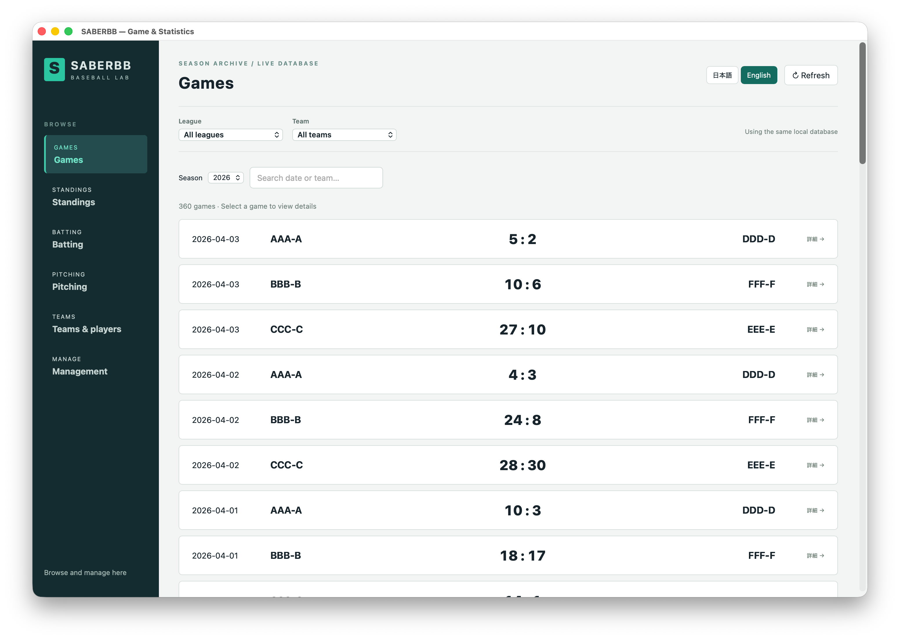

# saberbb

`saberbb` is a Rust CLI baseball simulation and statistics app. It generates
players, schedules seasons, simulates games, stores results in SQLite, and provides a Dioxus desktop GUI for management, standings and game results.

## Features

- Generate simulated baseball players with batting, pitching, fielding, and
  running attributes
- Schedule seasons and process game rounds
- Persist players, schedules, games, counts, and player game stats in SQLite
- Manage seasons and view standings and processed games in the desktop GUI
- Step through individual game counts with keyboard controls
- Support English and Japanese UI text through Fluent locale files

## Screenshots



## Requirements

- Rust toolchain with Cargo
- A SQLite database initialized with the project schema and seed data from
  [`migrations/`](migrations/)

The project uses Rust edition 2024. If your installed Rust version is old,
update it with `rustup update`.

## Quick Start

```sh
cargo build
cargo test
cargo run -- --help
```

Initialize the configured database from the project root:

```sh
cargo run -- --setup
```

This runs all `.sql` files in `migrations/ddl` followed by `migrations/dml`,
in filename order within each directory, then imports `migrations/data/first_names.csv`
and `migrations/data/last_names.csv` into their respective tables, preserving IDs
and all CSV fields. Both CSV files are required. Everything runs in a single
transaction; if a script or import fails, the changes are rolled back.
The scripts recreate tables and reset their
data, so use this command for a fresh database or an intentional reset. Setup
runs before any other options supplied in the same invocation.

For an existing database created before
`pitcher_character` was added, run
[`migrations/upgrades/add_pitcher_character.sql`](migrations/upgrades/add_pitcher_character.sql)
once instead of rebuilding the tables. This preserves existing pitchers and assigns
`Balanced` to them. Do not run this upgrade on a newly initialized database.

For databases created before `catcher_info` was added, run
[`migrations/upgrades/add_catcher_info.sql`](migrations/upgrades/add_catcher_info.sql)
once. It preserves catcher fielding data and initializes their calling style to
`Balanced`. New databases use `migrations/ddl/catcher_info_table.sql` instead.

Existing databases also need
[`migrations/upgrades/add_catcher_calling_style_weights.sql`](migrations/upgrades/add_catcher_calling_style_weights.sql)
once to configure randomized calling styles for newly generated catchers. New
databases receive these weights from `migrations/dml/item_weighted_sample.sql`.

For existing databases, run
[`migrations/upgrades/add_batting_contact_diagnostics.sql`](migrations/upgrades/add_batting_contact_diagnostics.sql)
once before saving new games. This preserves existing records; the new diagnostic
columns remain `NULL` for historical rows and takes. See
[`docs/batting_contact_diagnostics.md`](docs/batting_contact_diagnostics.md) for field definitions and analysis queries.

For existing databases, also run
[`migrations/upgrades/add_fielding_catch_diagnostics.sql`](migrations/upgrades/add_fielding_catch_diagnostics.sql)
once to enable fielding catch diagnostics. See
[`docs/fielding_catch_diagnostics.md`](docs/fielding_catch_diagnostics.md) for columns and single-pitch queries.

To record one diagnostic row per active fielder and fielded pitch, apply
[`migrations/upgrades/add_fielding_candidate_diagnostics.sql`](migrations/upgrades/add_fielding_candidate_diagnostics.sql).
This additive migration is repeatable. New databases also need
`migrations/ddl/player_game_fielding_candidate_table.sql`. See
[`docs/fielding_candidate_diagnostics.md`](docs/fielding_candidate_diagnostics.md)
for stage counts, maximum arrival margins, and analysis queries.

For the independent 10 ms airborne probe of all active fielders, apply
[`migrations/upgrades/add_fielding_air_probe.sql`](migrations/upgrades/add_fielding_air_probe.sql)
once after creating the candidate table. Historical probe columns remain `NULL`.
See [`docs/fielding_air_probe.md`](docs/fielding_air_probe.md) for interpretation and queries.

Typical simulation flow:

```sh
cargo run -- --generate 100
cargo run -- --schedule 1
cargo run -- --process 10
cargo run --features desktop -- --gui
```

The default database file is created at the platform-specific config path for
`jp.cosmi.saberbb`. Override `database_path` in the generated config file if you
want to point the app at a different SQLite file.

## Development

Build:

```sh
cargo build
```

Run tests:

```sh
cargo test
```

Format code:

```sh
cargo fmt
```

## Usage

Show CLI help:

```sh
cargo run -- --help
```

Available commands:

```sh
cargo run -- --setup           # Recreate tables and load seed data
cargo run -- --generate 10     # Generate 10 players and fill vacant team manager positions
cargo run -- --schedule 1      # Schedule 1 season
cargo run -- --process 5       # Process 5 game rounds without detailed contact diagnostics
cargo run -- --analysis 5      # Process 5 game rounds with detailed contact diagnostics
cargo run -- --sampleyear      # Clear game data, reset to this year, schedule 1 season, analyze 40 rounds
cargo run -- --maintenance     # Run SQLite VACUUM and PRAGMA optimize
cargo run -- --tui             # Management console: schedule, characters, game processing
cargo run --features desktop -- --gui  # Dioxus results/statistics GUI
```

`--process` and `--analysis` default to one round when the count is omitted.
`--sampleyear` uses the same analysis path as `--analysis`, recording contact states.
Ordinary processing skips both the detailed contact calculations and their persistence
in `player_game_contact_state`; existing records are retained. Explicit-seed diagnostic
runs continue to record contact states. Recording does not change game outcomes.

Short flags are also available:

```sh
cargo run -- -g 10
cargo run -- -s 1
cargo run -- -p 5
cargo run -- -m
cargo run -- -n
cargo run -- -v
```

## Interactive TUI

Open the TUI with:

```sh
cargo run -- --view
```

The menu includes standings and game results. Default controls are:

| Key | Action |
| --- | --- |
| Up / Down | Move selection |
| Enter | Confirm selection |
| Left / Right | Previous / next count in game detail |
| Esc / Backspace | Back |
| q / Ctrl+C / Ctrl+D | Quit |
| Ctrl+Z | Suspend |

## Configuration

Configuration is loaded with `confy` under the app name `saberbb`. On first run,
missing settings use these defaults:

```toml
version = 1
language = "en-US"
tick_rate = 1.0
frame_rate = 1.0
database_path = "/path/to/saberbb.db"
```

The default database path is `saberbb.db` inside the platform-specific config
directory for `jp.cosmi.saberbb`. Set `language` to `en-US` or `ja-JP` to switch
UI text.

Keybindings are stored by TUI mode. Missing keys are filled from the built-in
defaults, so you can override only the bindings you want to change:

```toml
[keybindings.Home]
"<q>" = "Quit"
"<down>" = "SelectNext"
"<up>" = "SelectPrevious"
"<enter>" = "ConfirmSelection"
```

Logs are written as daily JSON log files under the platform-specific data
directory for `jp.cosmi.saberbb`.

## Database

The SQLite schema and seed SQL files live in:

- [`migrations/`](migrations/)

Database documentation is generated in:

- [`docs/db/README.md`](docs/db/README.md)

The generated docs include the table list and ER diagram.

The DB docs are generated with [`tbls`](https://github.com/k1LoW/tbls):

```sh
tbls doc
```

## Project Structure

```text
src/
  adapters/       Terminal presenters and TUI components
  domain/         Baseball simulation and business logic
  repositories/   SQLite persistence layer
  config.rs       App configuration defaults and loading
  i18n.rs         Localization setup
  main.rs         CLI entry point

docs/
  db/             Generated database documentation
  mmd/            Mermaid diagrams for domain flows and classes
  wiki/           Domain notes

migrations/       SQL schema and seed files
locales/          Fluent translation files
tests/            Integration and simulation tests
```

## License

MIT. See [`LICENSE`](LICENSE).

For a controlled 0.05 s / 0.01 s diagnostic comparison, apply
[`add_fielding_air_probe_comparison.sql`](migrations/upgrades/add_fielding_air_probe_comparison.sql)
once to an existing probe-enabled DB, then run new games.
See [`docs/fielding_air_probe_comparison.md`](docs/fielding_air_probe_comparison.md) for queries.

The normal airborne search now uses 10 ms ticks with a shared event-boundary tolerance.
See [`docs/air_catch_search_validation.md`](docs/air_catch_search_validation.md)
for before/after queries and interpretation (no additional DB migration).

Swing/take decision changes and the one-time diagnostic DB upgrade are described in
[`docs/swing_decisions.md`](docs/swing_decisions.md).

Independent length/thickness miss classification and count/zone/timing queries:
[`docs/contact_miss_diagnostics.md`](docs/contact_miss_diagnostics.md).

Timing-position sensitivity at 100/75/50/0% with fixed contact geometry:
[`docs/timing_contact_probe.md`](docs/timing_contact_probe.md) (one-time bat-angle column upgrade).

75% timing-position trial and before/after contact-quality checks:
[`docs/timing_position_trial.md`](docs/timing_position_trial.md).

HLA component attribution and Marginal timing-resample comparison:
[`docs/hla_components.md`](docs/hla_components.md).

Signed contact-normal HLA trial, migration and before/after checks:
[`docs/contact_normal_hla.md`](docs/contact_normal_hla.md).

EV x VLA, first-ground response and energy-audited tangential collision prototypes:
[`docs/ground_spin_diagnostics.md`](docs/ground_spin_diagnostics.md).

Axial impact attribution: local velocity, rigid recoil and positional effective restitution:
[`docs/axial_response_diagnostics.md`](docs/axial_response_diagnostics.md).

Finite-barrel coupled normal/tangential impulses and spin consistency:
[`docs/finite_barrel_diagnostics.md`](docs/finite_barrel_diagnostics.md).

Single-experiment collision references and read-only per-pitch spin reconstruction:
[`docs/collision_validation.md`](docs/collision_validation.md).

### Generated managers

`--generate N` generates and distributes N players, then generates one manager for
every team that has no manager. Existing managers and assignments are preserved;
repeating the command when all teams have managers creates no extra managers.
`--generate 0` fills manager vacancies without creating players.
Manager names use the same language-specific dictionaries as player names. Each
manager receives one of the four existing batting policies with equal probability:
`let_batter_decide`, `put_ball_in_play`, `seek_line_drive`, or `situational`.
Manager IDs are allocated by SQLite independently of player IDs. Creation and team
assignment are saved together, and concurrent assignments never replace an existing
manager. Existing databases require the batting personnel migration:
`migrations/upgrades/add_batting_personnel.sql`.

## Desktop GUI and management TUI

Dioxus provides both results/statistics and management in one desktop app. The
TUI remains an optional management console for schedules, player/manager generation,
and ordinary or diagnostic game processing. CLI, TUI, and GUI call the same shared
application use cases.

```sh
cargo run -- --tui                       # --view / -v remain aliases
cargo run --features desktop -- --gui
```

The GUI reads the same configured SQLite database as the CLI. It includes league
and team filters, processed-season game lists, scoreboards, game summaries,
per-game batting/pitching tables, pitch-by-pitch navigation and pitch-zone/runner
SVGs, cumulative standings and player statistics, team schedules, player abilities,
pitch repertoires, and manager information. Tables support search, numeric sorting,
and pagination. Statistics retain the existing cumulative aggregation definitions;
the season selector on the game list only filters that list. Refresh reloads the
catalog and active data after management operations. Database work runs off the UI
thread. Viewing screens do not read `player_game_contact_state`.

GUI support is optional so ordinary CLI/TUI builds do not require a WebView SDK.
On macOS, install Apple's command-line tools (`xcode-select --install`). Linux
builds need GTK 3 and WebKitGTK 4.1 development packages, e.g. on Debian/Ubuntu:
`libgtk-3-dev libwebkit2gtk-4.1-dev libxdo-dev libayatana-appindicator3-dev`.
See [Dioxus desktop setup](https://dioxuslabs.com/learn/0.7/guides/platforms/desktop/).

For headless renderer testing, the local-only LiveView example uses the exact same
Dioxus components and database reads, without the native window wrapper:

```sh
cargo test --features gui-tests --lib application::viewing
cargo test --features gui-tests --lib adapters::gui
cargo run --features gui-tests --example gui_browser
# With a test DB containing processed games, dispatch real UI events and save HTML:
cargo run --features gui-tests --example gui_snapshots -- /tmp/saberbb-gui-snapshots
# http://127.0.0.1:8787 ; test harness only, not a public server
```

### GUI language and saved statistics

Use the **日本語 / English** buttons in the GUI header to switch labels and player
name order immediately. Japanese uses family name followed by given name; English
uses given name followed by family name. The preference is saved in the existing
configuration file, retaining the database path and keybindings. Startup language
initialization now overrides any earlier lazy default initialization.

Batting/pitching displays read `batting_stat_totals` and `pitching_stat_totals`.
At game-result save time, the same database transaction updates per-game rows in
`game_batting_stat_cache` / `game_pitching_stat_cache`, then refreshes totals for
only the affected players. Display queries never aggregate pitch logs or per-game
rows. Rates are derived from saved integer counts, preserving the existing
aggregation definitions (including the existing AB/innings definitions).

Existing databases are backfilled automatically on the first statistics request,
which may take time once. The additive schema is also in
`migrations/upgrades/add_stat_cache.sql`; manual SQL application is optional.
To explicitly rebuild derived statistics after manually editing/deleting raw logs:

```sh
cargo run -- --rebuild-stats
```

Rebuilds replace derived values; they do not add counts twice or alter raw pitch
records. `--setup` and `--sampleyear` clear all derived tables with the game data.
Neither the backfill nor display queries read `player_game_contact_state`.

Concurrent first-time statistics requests share one backfill within the application;
changing tabs or filters waits for that backfill instead of starting another writer.
No new games are needed to build statistics from existing logs. A database with no
played games displays empty statistics. Pooled connections wait up to 30 seconds
for locks held by other database work/processes; a persistent lock requires ending
the other transaction and refreshing, not resetting the database. To precompute
an existing database before opening the GUI, close other writers and run
`cargo run -- --rebuild-stats` once.

### GUI management

Open **管理 / Management** in the sidebar to run the same four operations as the TUI:

| Operation | Count | Behavior |
| --- | --- | --- |
| Create schedule | 1–255 seasons | Add future season schedules |
| Generate players & managers | 0–65535 players | Distribute players and fill vacant manager positions; 0 fills managers only |
| Process games | 1–65535 rounds | Simulate scheduled games without detailed contact diagnostics |
| Process with diagnostics | 1–65535 rounds | Simulate games and save detailed contact diagnostics |

Progress is reported after each saved player, season, or completed round. Only one
management job runs at a time in the GUI. Keep the app open until it finishes; page
navigation does not stop a running job. Language and manual refresh controls are
disabled while running. On success or failure, the catalog, statistics, games and
rosters refresh automatically; successful work saved before a failure is retained.
The management operations apply across the leagues rather than to viewing filters.

Game processing now selects the first unfinished scheduled round, including when
moving from the initial seed year or an exhausted season into a scheduled future
season. No pending games is an error without advancing the cursor. Unprocessed
past-season games require inspecting the cursor rather than silently skipping them.
This behavior is shared by CLI, TUI and GUI.

The optional mutating event harness below must use an isolated, freshly initialized
test database with no players or schedules. It checks the real GUI events and DB
writes, including duplicate clicks, page navigation during processing, normal vs.
diagnostic recording, error recovery and automatic refresh:

```sh
cargo run --features gui-tests --example gui_snapshots -- /tmp/gui-management --management
```

### Diagnostic duplicate-key repair

`--setup` now clears additive fielding-candidate/contact diagnostics together with
recreated game data. Older setup runs could leave these rows behind and reuse
game IDs, causing diagnostic primary-key conflicts. See
[the investigation and targeted repair](docs/fielding_candidate_duplicate_investigation.md).
Existing affected databases can remove diagnostics without completed parent games
using `migrations/upgrades/remove_orphaned_game_diagnostics.sql`; this preserves
completed-game diagnostics, results, rosters and schedules. Do not use `--setup`
as a repair command on a database whose existing game data should be retained.

### Expanded standings

The standings panel fills the pane width; only the table inside uses 90% of the panel width, centered with equal side margins.
Every team is shown without a row count or pagination.
A Season selector offers all seasons (the default) and each scheduled year, including seasons with no completed games.
Selecting a year scopes results, batting/fielding totals, rate denominators, and remaining games to that year.
Season views sum the small saved per-game team cache; they do not reaggregate pitch logs.

The GUI standings follow the column order of the
[Sports Navi standings](https://baseball.yahoo.co.jp/npb/standings/): rank, team,
games, wins, losses, draws, winning percentage, games behind, remaining games,
runs, runs allowed, home runs, stolen bases, batting average, ERA, and errors.
Standings use compact fixed-width columns to fit the available horizontal space.
League and season filters are shown; team selection and table search remain available
on other screens. A team selected on another screen does not restrict standings.
Win percentages and
team batting averages omit the leading zero (`.625`, `.250`); `1.000` remains
unchanged. Rates without a denominator display `—` (winning percentage remains
`.000` without a decisive game).

With All seasons selected, remaining games count all created but unplayed schedules,
including future seasons. With a year selected, only that season’s unplayed schedules
are counted. Remaining games are not a fixed league game limit minus games played.
Ranking and games behind are calculated within each league.

`game_team_stat_cache` and `team_stat_totals` are updated in the game-result save
transaction. Team attribution uses the game header and each count's top/bottom
side, preserving history when players change teams. A version-4 cache backfill
runs once on existing databases; `--rebuild-stats`, setup and season reset include
these new derived tables. Subsequent standings reads use saved team totals and
lightweight schedule counts, without reading detailed batting/running/fielding
logs, contact states or fielder-candidate diagnostics.

Team statistics use the following recorded information:

- Runs/runs allowed: completed game scores; home runs: batting results.
- Stolen bases: successful `BaseSteal` events; caught stealing and tag-ups excluded.
- Batting average: hits divided by completed at-bat outcomes (`Single`, `Double`,
  `Triple`, `HomeRun`, `Strikeout`, `Out`, `FieldersChoice`, `DoublePlay`). Takes,
  intermediate strikes, fouls, walks and HBP are excluded. Sacrifice plays are
  not separately classified by the current engine. Existing individual-player
  AB/AVG definitions are unchanged.
- ERA: **reference run-average**, runs allowed × 27 / recorded defensive outs.
  Earned runs are not yet stored. Outs come from the maximum recorded cumulative
  outs in each defensive half-inning; partial walk-off innings count only their
  recorded outs. This limitation is disclosed in the GUI.
- Errors: fielding records with an `error_type` other than NULL/empty/`None`.
  This is the engine's recorded fielding-error count, not an external scorer's
  ruling. Filtered/non-selected fielder-candidate diagnostics are not counted.

### Investigating excessive offense

The career batting table's `AB` counts terminal at-bats, excluding walks, hit by
pitch, takes, swinging strikes, fouls and nonterminal wild pitches. Cache version
4 corrects the previous pitch-record count used as `AB`. Existing databases
rebuild their derived caches once on the first statistics read; saved game logs
and home-run counts are preserved. This corrects the displayed denominator, not
an excessive number of simulated home runs. Sacrifices are not separately
recorded by the current result model.

Run the read-only audit against your saved database (no contact-state logging
or new simulated games required):

```sh
export SABERBB_DB="/path/to/saberbb.db"
python3 tools/diagnostics/offense_audit.py > offense_audit.json
# Optionally restrict the raw-log investigation to one season:
python3 tools/diagnostics/offense_audit.py --season 2026 > offense_audit_2026.json
```

The JSON separates pitch records, PA, AB and HR, reports the HR leader by game,
compares raw records with per-game caches and career totals, and summarizes EV,
launch angles, contact offsets and home-run geometry. `cache_mismatches` can show
incorrect AB values in version-3 caches; compare `raw_hr` and `cached_hr` separately.
The GUI player batting table currently covers all seasons, whereas the standings
can be season-filtered. The audit opens the database read-only and never rebuilds
caches. Normal game results still use `calculate_batted_ball_with_metrics`; the
Intent execution/contact/collision response path is diagnostic shadow data and
does not yet replace that live result calculation.

### Frozen-contact attack-angle ablation

Run the live Rust trajectory calculation on saved positive-EV batting records,
then vary only the sampled batter-type attack-angle contribution:

```sh
export SABERBB_DB="/path/to/saberbb.db"
cargo run --release --example attack_angle_ablation -- --season 2026 > attack_angle_ablation.json
# Start with the reported 441-HR batter for a smaller, faster comparison:
cargo run --release --example attack_angle_ablation -- --season 2026 --batter-id 7097 > attack_angle_7097.json
```

The output compares baseline, half the AggressiveFreeSwinger bonus, zero that
bonus, and zero all batter-type bonuses. Counts, mean launch angles, mean final
trajectory distances and outcome transition tables are provided for the total,
each batter type and each batter. `source_counts.raw_hr` covers every batting
record, allowing missing positive-EV HR records to be noticed. The comparison
cohort consists of positive-EV records, including fouls.

The baseline must reproduce the saved outbound result, final distance/angle and
time before a record can enter any scenario. Spin is reconstructed using the
same function as live simulation. EV, launch HLA, spin, contact geometry, stadium
(including a saved custom fence) and default wind stay fixed. The actual sampled
angle bonus is inferred by subtracting the shared contact-deflection and dynamic
attack-angle terms from saved VLA; no new random numbers are drawn. This assumes
that the batter's current base attack angle and type match their historical
values. Zero residuals are valid for records made after removal of the direct
bonus. Nonzero legacy residuals must be within 0.5–1.5 times the historical nominal
modifier, but this check cannot prove that the
player has never been edited. Older/missing inputs, baseline mismatches and
trajectory failures are counted in `exclusions`, with example record IDs.

Compare scenario HR counts only within the same `comparable_contacts` pool;
excluded records are not zero-HR outcomes. `comparison_available=false` means
there is no valid comparison. This is a read-only, frozen-contact experiment:
it does not replay pitching, batting decisions, fielding, running or innings,
and does not predict counterfactual BA/ERA or full-season HR totals. Final
trajectory distance includes ground rolling or fence termination and is not
unrestricted airborne carry. No live simulation coefficients are changed.

On the isolated 27-game development fixture, all 2,209 contacts reproduced their
baseline (no exclusions): 180 HR at baseline, 45 with half the aggressive bonus,
25 with no aggressive bonus, and 14 with no type bonus. These are development
fixture results, not estimates for another database's 441-HR batter.

### Live removal of direct batter-type angle bonuses

Live swing execution no longer adds the historical batter-type offsets (10° for
AggressiveFreeSwinger, 2° for ClassicAnalyst, 3° for GameManager). A batter's own
base attack angle and course-dependent dynamic angle remain. The historical RNG
draw is still consumed so removing this term does not independently shift the
random stream at that point. Player/manager preferences, intent selection and
other type-dependent decisions remain in place. Intent execution/collision
responses are still shadow diagnostics, not the live result generator.

Saved results are preserved; the change affects newly simulated games. Use the
read-only full-game check to evaluate a fresh run without resetting your DB:

```sh
export SABERBB_DB="/path/to/saberbb.db"
# Quick check, three seeds:
cargo run --release --example offense_season_check -- --season 2026 --games 36 > offense_season_check.json
# 360 league games (120 per team in a six-team balanced schedule), three seeds:
cargo run --release --example offense_season_check -- --season 2026 --games 360 > offense_season_360.json
```

Omit `--games` to run every scheduled game of that season, completed or pending.
The checker reads current rosters, managers, stadium settings and the requested
schedule; it does not reproduce historical lineups or unknown historical seeds.
Each game starts from its frozen input and a seed derived from the master seed
and game ID, using the same full simulation loop as ordinary play. It does not
save results, advance the cursor or collect contact-state diagnostics. Failure
aborts the run rather than accepting a partial summary. Progress goes to stderr;
JSON goes to stdout. Input and engine hashes identify what was compared.

The reports include batting average, HR/PA, runs, hits by type, strikeouts,
recorded pitching outs, non-strikeout outs, HR leaders and team totals. The RA9
reference uses runs allowed * 27 / recorded outs; earned runs are not recorded.
Non-strikeout outs include baserunning outs. Compare before/after runs only with
matching input hashes, game counts and seed lists. Different outcomes naturally
change subsequent random consumption and plate appearances. Do not combine old
saved statistics and newly generated statistics as one calibration comparison.

See [the full-game comparison and remaining calibration issues](docs/diagnostics/type_angle_bonus_removal.md) for the 360-game, three-seed development check.

### Ball-in-play quality and conversion audit

Append `--bip-diagnostics` to the full-game check to separate contact quality,
fielding paths and running/throwing timings without changing game outcomes:

```sh
export SABERBB_DB="/path/to/saberbb.db"
cargo run --release --example offense_season_check -- --season 2026 --games 36 --bip-diagnostics > bip_audit_36.json
# Full comparison on your current roster, three default seeds:
cargo run --release --example offense_season_check -- --season 2026 --games 360 --bip-diagnostics > bip_audit_360.json
```

Each seed report gains `bip_diagnostics`, including an all-contact quality/foul/HR funnel and per-play outcome counts and hit rates
by engine trajectory, EV (m/s), VLA, contact quality, fielding position, selection
path, catch type and error, plus a joint trajectory/EV/VLA table. Table groups partition
the same terminal BIP population (Single/Double/Triple/Out/FC/DP). Home runs,
strikeouts and nonterminal fouls are excluded. Automatic ground-rule doubles
remain in the denominator and have their own coverage count; missing fielding
records are not mislabeled as zero-time plays. A double play counts as one BIP,
not two outs.

Timing summaries carry their own sample counts; absent values are never replaced
by zero. `target_runner_margin_sec` compares the recorded defense/runner times
only for a known target with positive runner time; it may be a lead runner, not
the batter. Batter first-base times include the live acceleration lag. The
second/third no-lag times deliberately match the current outfield RunningPlan
thresholds, and plan-versus-attempt lag summaries expose the difference from
actual timed attempts. A single followed by the batter being tagged out while
stretching to second is tracked separately from possible classification errors.

The audit includes bounded examples (first four per flag) with game/count IDs,
fielding/running records, relevant batter times and candidate coverage. Air probe
success is a counterfactual search result, not a guaranteed catch. Catch positions
are reconstructed only for error-free DirectFly/BounceCatch records using the
same coarse estimator as fielding; FinalPickup and errors are excluded because
handling delay obscures the interception instant. Final-versus-catch distances
and straight-line distances to the recorded throw target are diagnostic geometry,
not corrected throw times or counterfactual safe/out decisions.

This is an observer over completed GameResult records: no new RNG, no new contact
logging, no DB writes, and no changes to physics, running or fielding coefficients.
A missing flag key means zero occurrences; samples are illustrative, not randomly
representative. See [BIP diagnostic findings](docs/diagnostics/bip_conversion_audit.md)
for coverage, parity checks and the initial development fixture findings.

For a frozen-contact HLA component comparison and same-target throw-origin timing
comparison, add `--contact-direction-diagnostics` alongside `--bip-diagnostics`.
See [definitions, limitations and running clock correction](docs/diagnostics/contact_direction_audit.md).

### Frozen-contact moving-bat comparison

Compare the recorded live outcome with stationary/moving normal and full finite
collision responses, including HLA-only sensitivity and common-contact controls:

```sh
export SABERBB_DB="/path/to/saberbb.db"
cargo run --release --example offense_season_check -- --season 2026 --games 360 --moving-collision-diagnostics > moving_collision_360.json
```

This observer retains the live contact cohort, saves no results/contact states,
and reports model exclusions and separate matched denominators. The legacy 3-D
pose is a documented proxy, not a measured state. See [model assumptions, spin
projection and output definitions](docs/diagnostics/moving_collision_audit.md).

### Selected Intent forward 3-D path

Compare live contact/miss labels with the selected Intent's existing execution
and 3-D contact search, then aggregate its finite collision/flight response:

```sh
export SABERBB_DB="/path/to/saberbb.db"
cargo run --release --example offense_season_check -- --season 2026 --games 360 --selected-intent-diagnostics > selected_intent_3d_360.json
```

This flag collects raw shadow states for one game at a time in memory and saves
none to the database. It includes legacy misses, separates unresolved searches
and model exclusions, and preserves ordinary results. See [cohorts, assumptions
and validation](docs/diagnostics/selected_intent_3d_audit.md).
