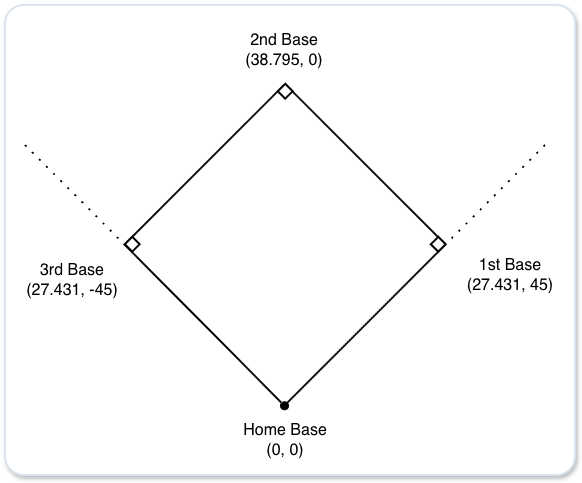

# Batting Physics

Source: [batting_resolver.rs](../../../src/domain/resolver/batting_resolver.rs), as of 2026-11-06.

## Coordinates and scope



World X is lateral, Y is forward and Z is height. Stadium locations also use distance and spray angle from home. Units are m/s, seconds, degrees and rpm.
Live games use the empirical formulas below. The newer 3D finite-bat model couples normal/tangential impulses, exit velocity and spin in diagnostics only.

## Exit velocity (EV)

Let L and T be absolute length/thickness offsets from [contact evaluation](batting_logic.md), and q the timing-derived displacement.

```text
p = sigmoid(swing_power)
q < 0: effective_power = p * (1 + 0.05*clamp(abs(q)/0.20, 0, 1))
q >= 0: effective_power = p * (1 - 0.15*clamp(q/0.20, 0, 1))
c_swing = 1.12 + 0.16*effective_power
EV_max = 0.18*ball_speed + c_swing*swing_speed
```

For T≤0.020m, `e_thick=1`; for T≥0.070m, it is zero. Between those bounds:

```text
e_thick = cos(((T-0.020)/0.050)*pi/2)^2
e_len = clamp(1-(L/0.350)^2, 0, 1)
EV = EV_max * e_thick * e_len
```

Thickness decay uses T, not L. Exit speed is not drawn from a fixed distribution per ContactType.

## Vertical launch angle (VLA)

```text
VLA = attack_angle_deg + 0.60*degrees(asin(clamp(offset_z_m/0.070, -1, 1)))
```

This uses world-frame vertical offset, rather than solving a single 3D collision from signed thickness. High EV with a strongly negative VLA still produces a hard downward ball.

## Horizontal launch angle (HLA, version 2)

Use the contact projection's signed thickness and actual tilt theta:

```text
s = clamp(thickness_signed/0.070, -1, 1)
n = (-sin(theta)*s, sqrt(1-s*s), cos(theta)*s)
reflected = (0,-1,0) + 2*n.y*n
rebound_hla = degrees(atan2(reflected.x, reflected.y))
HLA = wrap_to_180(handedness * (0.85*face_angle_deg + rebound_hla))
```

Face angle retains the existing approach/pull draws and original timing error. The 0.75 displacement scale does not shorten that error, and Marginal contact no longer resamples it.
HLA is not clamped to ±90 degrees; backward balls retain signed forward velocity. This is an idealized horizontal reflection approximation, not a common conservation-law solution for EV, VLA and spin. See [the HLA model](../../contact_normal_hla.md).

## Spin

```text
d = min(sqrt(L*L + T*T), 1)
collision_rpm = 4000 * (swing_speed/33.333) * d
```

Collision spin derived from contact angle is combined with 20% of pitch spin using the two-component `SpinVector`. This still uses absolute L/T, rather than a complete signed 3D contact and angular-velocity calculation. Energy allocation between EV and spin is not coupled.
Spin direction changes the force direction: more spin does not always increase distance. No dedicated low-spin flutter model is implemented.

## Trajectory

Start at `(0,0,0.90)` m and decompose velocity as follows. Integrate gravity, drag, wind, Magnus acceleration, bounces and fences in 0.01s steps.

```text
vx = EV*cos(VLA)*sin(HLA)
vy = EV*cos(VLA)*cos(HLA)
vz = EV*sin(VLA)
```

| Constant | Value |
| --- | ---: |
| AIR_RESISTANCE_COEFF | 0.0012 |
| MAGNUS_COEFF | 0.0000336 |
| RESTITUTION_COEFF (ground) | 0.45 |
| WALL_RESTITUTION | 0.60 |
| GROUND_FRICTION | 0.25 |

A foul-side boundary collision, including the backstop, terminates as Foul without reflecting forward. Fair fence clearance before a bounce is HomeRun; after a bounce it is GroundRuleDouble. Foul direction is checked first, preventing foul-side clearance from awarding a double.
First-bounce and fence-impact times and positions are recorded. [Fielding trajectory estimation](fielding_logic.md) does not rerun this integrator.

## Diagnostic finite-bat collision

[finite_bat_collision.rs](../../../src/domain/shared/finite_bat_collision.rs) is a pure response function using incoming velocity/spin, local bat velocity, finite mass/inertia, normal restitution, friction and tangential restitution.
The diagnostic connection freezes `finite_I0.00015_et0.4`, records a frictionless control and energy/impulse checks, and supports Rust/Python parity audits. Endcaps, out-of-range inputs and nonconvergence retain explicit statuses.
This has not replaced the live empirical formulas. See [diagnostics and holdouts](diagnostics.md) and [Rust response specification](../../rust_collision_response.md).
