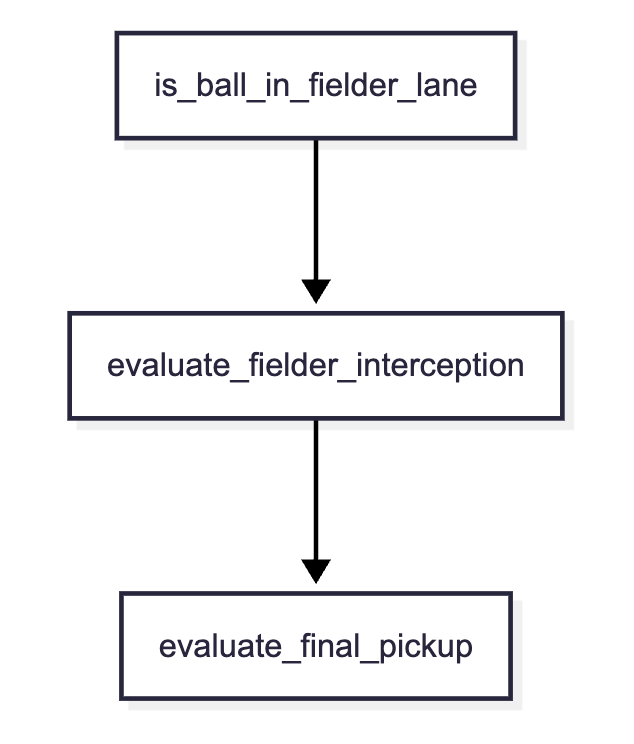

# Fielding Logic

# Fielding Process Flow

### 1. is_ball_in_fielder_lane

Determine which fielders can catch the ball along the batted-ball trajectory.

#### Catchable Range by Fielder

| Fielder type | Catchable angle |
| ---- | ---- |
| Pitcher | 4.0° |
| First baseman, third baseman | 6.0° |
| Second baseman, shortstop | 8.0° |
| Outfielder | 12.0° |

$$\theta_{\text{coverage}} = \theta_{\text{coverage}} \cdot (1.0 + \text{FielderInfo.reach\_range} \cdot 0.05)$$

#### Determining Whether the Ball Is Catchable

$$\theta_{\text{fielder}} - \theta_{\text{ball}} \le \theta_{\text{coverage}}$$

### 2. evaluate_fielder_interception

Stop the ball mid-play while it is in flight or bouncing as a ground ball (fly-ball catch, ground-ball fielding).

#### Get the Current Position of the Batted Ball
`estimate_ball_state_at_time()` interpolates Cartesian segments through home,
the recorded first bounce and fence impact in chronological order, and the final
position. Angles are recovered from X/Y instead of interpolating from angle zero.
The recorded landing position is reached at its timestamp; rolling time does not
stretch the initial flight.

Height uses `4 * max_height * p * (1 - p)` over the time to the first ground bounce.
After that bounce it is approximated as ground level (0 m); later hops are not
reconstructed. A fence impact ends direct-fly eligibility immediately, even when
the ball remains above ground until a later first bounce. Without a ground event,
the fence time or total time supplies the available height boundary.
This is a coarse envelope, not a replay of the batting integrator: initial contact
height (0.9 m) and actual fence-impact height are not stored in this reconstruction.

Zero-time bounces, zero-duration balls, and queries after the ball stops avoid
zero division. Time-only event records fall back to a point on the final ray;
out-of-range event times are ignored.

#### Move to the Future Position Where the Fielder Can Catch the Ball
1. Determine travel time
- Calculate the time $t_{\text{fielder}}$ required for the fielder to move from the initial position to the ball's horizontal position $(X(t), Y(t))$.
$$t_{\text{fielder}} = t_{\text{prep}} + \frac{\text{Distance}((X_{\text{f0}}, Y_{\text{f0}}), (X(t), Y(t)))}{v_{\text{fielder}}}$$

2. If there is enough time to reach the ball's horizontal position, get there ahead of the ball
$$t_{\text{fielder}} \le t_{\text{ball}}$$
- If the fielder has enough time to get there first ($t_{\text{fielder}} < t$), the fielder waits at that point for the ball to come down and can attempt a catch subject to risk and error checks.

3. Determine whether the ball is at a catchable height
$$Z(t) \le Z_{\text{catch\_max}}$$

### 3. evaluate_final_pickup

Search from fence impact, otherwise first bounce, otherwise time zero, in 0.05s steps. The target may still be moving; it is not limited to the final resting position.
Required time is `prep_time + distance/running_speed`. Add handling delay at the first reachable point: 0.65s for a moving cushion ball, 0.40s otherwise. A fumble adds a further 1.5–2.5s.
Do not add travel time and ball-stop time unconditionally.

### Error Judgment

| Error type | Trigger condition | Wait time | Ball position | Error handling |
| ---- | ---- | ---- | ---- | ---- |
| Fumble | Ball pops out of glove   Bobble | Stops in place or at the fielder's feet | Enough time | Add a penalty to processing time |
| Missed ball | Catch while charging   Backhand attempt   Forced dive | Just barely | Continues rolling backward | Move to backup handling |

#### Calculating Error Probability

Normal interception uses `clamp(1-catching, 0.01, 0.50) * difficulty * 0.10`, with difficulty=3 for waiting time below 0.2s, otherwise 1. Final pickup uses its separate error formula.

- Elements of $\text{DifficultyFactor}$
  - Lack of waiting time (a just-barely catch is more difficult)
  - Batted-ball velocity $v$

### Risk Strategy for Catching Before a Bounce

Required margins: Aggressive=0s, Balanced=0.15s, Conservative=0.35s. Conservative can still attempt a DirectFly with sufficient margin.

- $Aggressive$ (challenge-first):
  - If there is a chance to catch the ball before it bounces, the fielder dives in aggressively even when wait time is almost zero, such as on a last-second diving attempt.
- $Balanced$:
  - Even if there is a chance to catch the ball before it bounces, if wait time is below a certain threshold, the fielder chooses a safer fielding point.
- $Conservative$ (safety-first):
  - If no airborne point satisfies the required margin, continue searching after the bounce.

## Search and diagnostics as of 2026-11-06

Sources: [fielding_physics.rs](../../../src/domain/resolver/fielding_physics.rs) and [fielding_resolver.rs](../../../src/domain/resolver/fielding_resolver.rs).

Live interception starts at 0.10s, advancing by 0.01s in the air, then returning to the original `0.10 + n*0.05` grid after the first valid bounce/fence event. Times come from integer ticks. A point within 1e-9s of the event is not DirectFly.
The travel-time formula uses `prep_time` for t_prep; it does not add a separate `reaction` delay. Reachability does not guarantee success: required risk margin and error draws still apply.

Candidates must pass direction and `fielder.distance() <= ball.distance()` filters. Evaluate each eligible fielder once, then select the earliest interception. A Passed error triggers final-pickup comparison across all fielders; if no candidate intercepts, final pickups also consider all fielders.

| Record | Meaning |
| --- | --- |
| selection_path | interception / covering / final_pickup |
| catch_type / error_type | Effective interception's catch and error types |
| player_game_fielding_candidate | One row per active fielder and fielded pitch, including filtered fielders |
| search | Actual search prefix through first catch/error or exhaustion |
| air_probe / air_probe_coarse | Independent full-air-interval scans at 10ms / 50ms for every active fielder |

Probes consume no random draws, ignore candidate filters and scan beyond the first feasible point. Probe feasibility is not an actual catch/out and does not change live selection.
Filtered fielders retaining feasible samples is separate from insufficient time resolution. See [diagnostics](diagnostics.md) and [air search comparison](../../air_catch_search_validation.md) for upgrades, stage counts, margins and comparisons.
