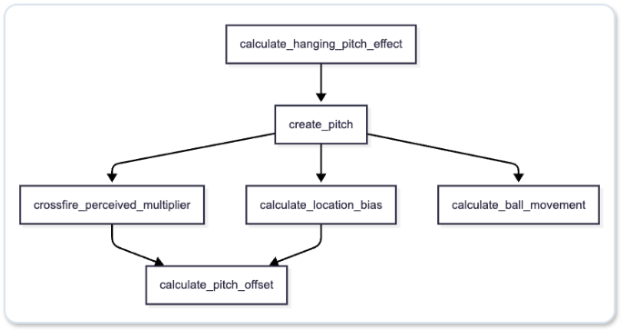

# Pitching Logic

# Pitching Process Flow

# 1. calculate_hanging_pitch_effect

#### Determining a Mistake Pitch

A mistake pitch occurs when the random value exceeds $\text{PitcherInfo.consistency}$.

# 2. create_pitch

Collect the pitching result into `PitchedBall`.

## 2.1 spin angle

#### Base Axis by Arm Slot

| Pitching form | Angle |
| ---- | ---- |
| Overhand | 25° |
| ThreeQuarter | 55° |
| Sidearm | 85° |
| Submarine | 115° |

#### Angle Conversion for Left-Handed Pitchers

$$\text{spin\_dir} = (360.0 - \text{spin\_dir})\bmod 360.0$$

## 2.2 Pitch decision and execution

Live `process_count` selects a situational Strategy and generates separate Preferences from PitcherCharacter and catcher calling_style.
A shared `PitchEvaluationContext` produces pitcher proposals (up to 3 pitch types and 2 locations) and catcher proposals (up to 4). Both sides reevaluate their union; weight 0.5 selects the PitchCall executed by `create_pitch_for_call`. No valid candidate raises NoPitchCall.
The previous call persists within a plate appearance and resets for the next batter. See [pitch-call reconciliation](pitch_call_decision.md).

The old distribution-sampling `create_pitch` remains as a wrapper and is used for the expected pitch. It is not the live actual-pitch selection pipeline.

## 2.3 calculate_release_point

#### Z Axis (Height): Multiply Height by the Form Coefficient

| Pitching form | Coefficient |
| ---- | ----: |
| Overhand | 1.05 |
| ThreeQuarter | 0.95 |
| Sidearm | 0.7 |
| Submarine | 0.4 |

#### X Axis (Lateral Position): Lateral Spread from Arm Slot

| Pitching form | Coefficient |
| ---- | ----: |
| Overhand | 0.35 |
| ThreeQuarter | 0.55 |
| Sidearm | 0.85 |
| Submarine | 0.6 |

#### Y Axis (Distance to Batter):

$18.44(m) - PitcherInfo.extension$

- 18.44 m: distance from the mound to home plate

# 3. crossfire_perceived_multiplier

#### Approach-Angle Correction Based on Batter Familiarity

$$\text{HAA}_{\text{perceived}} = \text{HAA}_{\text{physical}} \times \text{UnfamiliarityFactor}$$

- Right-handed pitcher vs. right-handed batter / left-handed pitcher vs. left-handed batter (same-side matchup): $\text{UnfamiliarityFactor}=1.0$ (standard)
- Right-handed pitcher vs. left-handed batter: $\text{UnfamiliarityFactor}=1.0$ (no correction because left-handed batters are used to crossfire from right-handed pitchers)
- Left-handed pitcher vs. right-handed batter: $\text{UnfamiliarityFactor}=1.25 to 1.35$ (perceived angle is emphasized due to rarity)

# 4. calculate_location_bias

Additional timing, horizontal and vertical location biases are all currently zero. The former inside +12ms/outside −10ms and location-proportional spatial offsets are inactive. Movement mismatch, crossfire, release width and perception errors remain separate active terms.

# 5. calculate_pitch_offset

1. Calculate the remaining time from the batter's swing-decision point to the actual impact point.

2. Calculate the horizontal offset during the remaining time.
$$\text{spacial\_offset\_x} = \frac{1}{2} \cdot (\Delta x_{\text{actual}} - \Delta x_{\text{predicted}}) \cdot t_{\text{remaining}}^2 $$

3. Add the effects of crossfire, location, and release point to the horizontal offset.
$$\text{enhanced\_offset\_x} = \text{spacial\_offset\_x} \cdot \text{crossfire\_multiplier} \cdot \text{release\_x\_factor} + \text{location\_bias} $$

4. Calculate the vertical offset during the remaining time.
$$\text{spacial\_offset\_y} = \frac{1}{2} \cdot (\Delta y_{\text{actual}} - \Delta y_{\text{predicted}}) \cdot t_{\text{remaining}}^2 $$

5. Add the effect of location to the vertical offset.

$$\text{enhanced\_offset\_y} = \text{spacial\_offset\_y} + \text{location\_bias} $$

6. Add the effect of location to the timing offset.

$$\text{enhanced\_timing\_offset} = \text{timing\_offset} + \text{location\_bias} $$

# 6. calculate_ball_movement

1. Calculate the pitch flight time until the batter's impact point.
2. Calculate the horizontal movement distance.
3. Calculate the vertical movement distance.
- Include the effect of gravity.

## Timing perception and ability

`calculate_timing_offset` attenuates flight-time differences and perception noise with `1-sigmoid(batting_eye)`: higher batting_eye reduces error. Contact adaptation separately uses `1-sigmoid(bat_control)`; see [batting logic](batting_logic.md).
