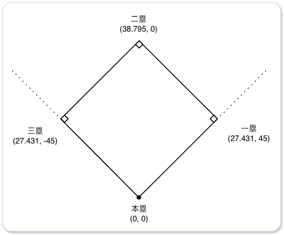

# 打球の物理

実装: [batting_resolver.rs](../../../src/domain/resolver/batting_resolver.rs)。2026-11-06時点。

## 座標と適用範囲



世界座標はXが横、Yが前方、Zが高さ。球場上の位置はホームからの距離と方向角でも表す。速度はm/s、時間は秒、角度は度、回転数はrpm。
通常試合は以下の経験式を使用する。3D有限バットの法線・接線衝撃量からEV/VLA/回転を一体計算する新モデルは診断用であり、通常打球にはまだ適用しない。

## 接触から初速（EV）

[接触判定](batting_logic.md)で得た長さ方向の絶対値をL、厚み方向をT、タイミング由来の位置ずれをqとする。

```text
p = sigmoid(swing_power)
q < 0: effective_power = p * (1 + 0.05*clamp(abs(q)/0.20, 0, 1))
q >= 0: effective_power = p * (1 - 0.15*clamp(q/0.20, 0, 1))
c_swing = 1.12 + 0.16*effective_power
EV_max = 0.18*ball_speed + c_swing*swing_speed
```

T≤0.020mなら `e_thick=1`、T≥0.070mなら0。その間は次のcos²減衰を使う。

```text
e_thick = cos(((T-0.020)/0.050)*pi/2)^2
e_len = clamp(1-(L/0.350)^2, 0, 1)
EV = EV_max * e_thick * e_len
```

厚み減衰に使うのはTでありLではない。ContactType別に固定のEVを抽選するモデルではない。

## 垂直打出し角（VLA）

```text
VLA = attack_angle_deg + 0.60*degrees(asin(clamp(offset_z_m/0.070, -1, 1)))
```

ここで使うのは世界座標側のzずれ。符号付き厚み座標から一貫した3D衝突を解いているわけではない。EVが高くてもVLAが大きく負なら下向きの強い打球となる。

## 水平打出し角（HLA、version 2）

接触判定と同じprojectionを使い、バット傾斜thetaと符号付き厚みから反射方向を作る。

```text
s = clamp(thickness_signed/0.070, -1, 1)
n = (-sin(theta)*s, sqrt(1-s*s), cos(theta)*s)
reflected = (0,-1,0) + 2*n.y*n
rebound_hla = degrees(atan2(reflected.x, reflected.y))
HLA = wrap_to_180(handedness * (0.85*face_angle_deg + rebound_hla))
```

face angleは既存のapproach/pull抽選と元の時間差から求める。接触位置の0.75係数で元時間差を縮めず、Marginal専用のタイミング再抽選もしない。
HLAを±90度に丸めない。後方打球も符号付き前後速度を保持する。これは水平方向の理想反射近似であり、EV・VLA・回転を同じ保存則から導くモデルではない。[HLAモデル](../../contact_normal_hla.md)を参照。

## 回転

```text
d = min(sqrt(L*L + T*T), 1)
collision_rpm = 4000 * (swing_speed/33.333) * d
```

接触角から求めた衝突回転と投球回転の20%を、`SpinVector` の2成分ベクトルとして合成する。ここではL/Tの絶対値を使う。符号付き接触・入射角速度を使う完全な3D回転計算ではなく、EVと回転へのエネルギー配分も連成していない。
バックスピン・トップスピン・サイドスピンは力の向きを変えるため、「回転が多いほど必ず遠くへ飛ぶ」とは扱えない。低回転の不規則な揺れを生成する専用モデルもない。

## 軌道

初期位置は `(0,0,0.90)` m。速度を次のように分解し、0.01秒刻みで重力・空気抵抗・風・マグヌス効果・バウンド・フェンスを処理する。

```text
vx = EV*cos(VLA)*sin(HLA)
vy = EV*cos(VLA)*cos(HLA)
vz = EV*sin(VLA)
```

| 定数 | 値 |
| --- | ---: |
| AIR_RESISTANCE_COEFF | 0.0012 |
| MAGNUS_COEFF | 0.0000336 |
| RESTITUTION_COEFF（地面） | 0.45 |
| WALL_RESTITUTION | 0.60 |
| GROUND_FRICTION | 0.25 |

ファウル側の境界衝突（バックネットを含む）はFoulとして終了し、前方へ反射させない。フェア側でノーバウンドの柵越えはHomeRun、バウンド後の柵越えはGroundRuleDouble。Foul判定を先に行い、ファウル側の柵越えを二塁打にしない。
最初のバウンド・フェンス衝突の位置と時刻を保存する。[守備側の軌道推定](fielding_logic.md)はこの積分の再実行ではない。

## 診断用の有限バット衝突

[finite_bat_collision.rs](../../../src/domain/shared/finite_bat_collision.rs) は入射速度・回転、局所バット速度、有限質量・慣性、法線反発・摩擦・接線反発から出射速度と回転を計算する純粋な応答関数。
現行の接続は `finite_I0.00015_et0.4` に固定し、摩擦なし対照、エネルギー・衝撃量の検査、Rust/Python照合を記録する。端部・適用範囲外・未収束等を別状態として保持する。
通常の経験式を置き換えたと解釈せず、[診断とholdout](diagnostics.md)、[Rust応答仕様](../../rust_collision_response.md)から適用範囲と検証手順を確認する。
