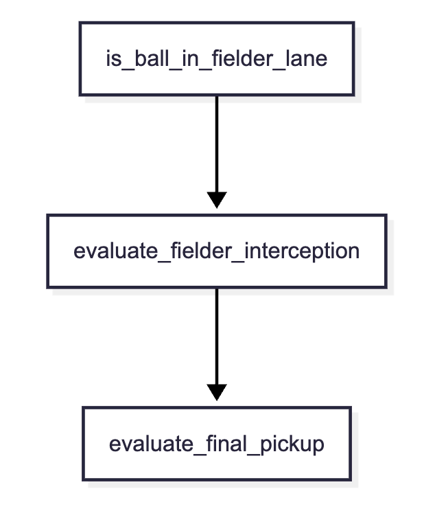

# 守備ロジック

# 守備処理の流れ

### 1. is_ball_in_fielder_lane

打球軌道上の捕球可能な野手を判定する

#### 野手別の捕球可能範囲

| 野手の種類 | 捕球可能な角度 |
| ---- | ---- |
| 投手 | 4.0° |
| 一塁手、三塁手 | 6.0° |
| 二塁手、遊撃手 | 8.0° |
| 外野手 | 12.0° |

$$\theta_{\text{coverage}} = \theta_{\text{coverage}} \cdot (1.0 + \text{FielderInfo.reach\_range} \cdot 0.05)$$

#### 捕球可能かどうかの判定

$$\theta_{\text{fielder}} - \theta_{\text{ball}} \le \theta_{\text{coverage}}$$

### 2. evaluate_fielder_interception

飛翔中・ゴロでバウンド中のボールを途中で止める（フライ捕球、ゴロ捕球）。

#### 打球の現在位置の取得
`estimate_ball_state_at_time()` は、ホーム → 最初の着地・フェンス衝突（発生時刻順）→ 最終位置を
直交座標上の線分で補間する。最初の着地時刻には記録済みの着地位置へ到達し、
着地後の転がり時間を空中軌道へ含めない。角度は補間後のX/Yから計算する。

高さは最初の着地までの時間を基準に、`4 × max_height × p × (1 − p)` で近似する。
着地以降は地面の高さ0mとして扱い、再バウンドの高さは再現しない。
フェンス衝突が着地より先なら、高さの近似は着地まで続くが、衝突以降は
ノーバウンド捕球（`is_direct`）として扱わない。
着地時刻がない場合はフェンス衝突時刻、どちらもなければ全体時間を高さの終端とする。
この近似は打球生成側の物理積分そのものを再実行するものではなく、
打球開始時の0.9mの高さやフェンス衝突時の実測高さは保持していない。

時刻0の着地、全体時間0、停止後の問い合わせでもゼロ除算を避ける。
有効な時刻だけがあり位置がない記録では、最終方向上の補間位置を仮の境界点にする。

#### 野手が捕球可能な高さの打球の将来位置に移動
1. 移動時間の判定
- 野手が初期位置からボールの水平位置 $(X(t), Y(t))$ に移動するのに必要な時間 $t_{\text{fielder}}$ を計算
$$t_{\text{fielder}} = t_{\text{prep}} + \frac{\text{Distance}((X_{\text{f0}}, Y_{\text{f0}}), (X(t), Y(t)))}{v_{\text{fielder}}}$$

2. ボールの水平位置への到達時間に余裕がある場合は、先回りする
$$t_{\text{fielder}} \le t_{\text{ball}}$$
- 到達後の余裕が要求値以上なら捕球を試みる。到達可能でもリスク判定やエラー抽選があるため、捕球成功は確定しない。

3. 捕球可能な高さの判定
$$Z(t) \le Z_{\text{catch\_max}}$$

### 3. evaluate_final_pickup

ボールの軌道上で野手が止められず、ボールがフェンス際や外野の奥で停止、または減速した後に、最も近い野手がボールを捕球する

#### 現在の拾球探索

`evaluate_final_pickup` はフェンス衝突時刻、なければ最初のバウンド時刻、どちらもなければ0から0.05秒刻みで探索する。最終停止位置だけでなく、移動中の球も対象。
野手の必要時間は `prep_time + 移動距離/running_speed`。到達できる最初の点の時刻へ処理遅延を加える。
移動中のクッションボールは0.65秒、それ以外は0.40秒。ファンブルならさらに1.5〜2.5秒の遅延を加える。
したがって「走行時間＋停止時間」を一律に加算する式ではない。

### エラー判定

| エラー種別 | 発生条件 | 待ち時間 | ボール位置 | エラー対応 |
| ---- | ---- | ---- | ---- | ---- |
| ファンブル | ミット弾き   お手玉 | その場、または足元で停止 | 余裕あり | 処理時間にペナルティ加算 |
| 後逸 | 走り込みながらの捕球   逆シングル   無理なダイビング | ギリギリ | そのまま後方へ転がる | カバー処理に移行 |

#### エラー確率の算出

通常interceptionでは `clamp(1-catching, 0.01, 0.50) * difficulty * 0.10`。待ち時間0.2秒未満ならdifficulty=3、それ以外は1。final pickupは上記とは別の式を使う。

- $\text{DifficultyFactor}$の要素
  - 待機時間の少なさ（ギリギリの捕球ほど高難易度）

### ノーバウンド捕球時のリスク戦略

要求余裕はAggressive=0秒、Balanced=0.15秒、Conservative=0.35秒。慎重型も余裕が十分ならDirectFlyを試みる。

- $Aggressive$（攻撃的 / チャレンジ優先）：
  - ノーバウンドでの捕球チャンスがあれば、待ち時間がほぼゼロ（ギリギリのダイビング等）であっても積極的に飛び込む
- $Balanced$（バランス型）：
  - ノーバウンドで捕球できるチャンスがある場合でも、待ち時間が一定基準を下回る状況であれば、安全な捕球ポイントで捕球する
- $Conservative$（慎重型 / 安全第一）：
  - 要求余裕を満たす空中捕球点がなければ、バウンド後の捕球点へ探索を続ける。

## 2026-11-06時点の探索と診断

実装: [fielding_physics.rs](../../../src/domain/resolver/fielding_physics.rs)、[fielding_resolver.rs](../../../src/domain/resolver/fielding_resolver.rs)。

通常のinterception探索は0.10秒開始。空中では0.01秒刻み、最初の有効なバウンド／フェンス衝突以後は元の `0.10 + n*0.05` グリッドへ戻る。整数tickから時刻を作り、イベントとの差が1e-9秒以下ならDirectFlyにしない。
移動時間は上式のt_prepに `prep_time` を使う。`reaction` を別途加算しない。

候補は方向フィルタと `fielder.distance() <= ball.distance()` の距離フィルタを通った野手。各候補を1回評価し、捕球時刻が最も早いものを選ぶ。Passedなら全野手のfinal pickupを比較してカバーし、候補が捕れなかった場合も全野手のfinal pickupを比較する。

| 記録 | 意味 |
| --- | --- |
| selection_path | interception / covering / final_pickup |
| catch_type / error_type | 最終的に有効な捕球の種類とエラー |
| player_game_fielding_candidate | 1球×全アクティブ野手。フィルタ除外も記録 |
| search | 通常探索の最初の捕球・エラーまたは探索終了までの経過 |
| air_probe / air_probe_coarse | 全野手について全空中区間を10ms / 50msで走査する独立診断 |

probeは乱数を消費せず、フィルタや最初の成立点で打ち切らない。probe成立は実際の捕球・アウトを意味せず、通常の担当野手も変更しない。
フィルタ除外野手に成立点が残ることと、通常探索の刻み不足は別の論点。
既存DBへの追加移行、段階別件数、最大余裕、粗密比較の手順は[診断一覧](diagnostics.md)および[空中探索比較](../../air_catch_search_validation.md)を参照。
